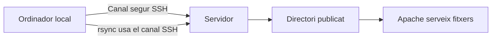

# Bloc 2: SSH i rsync - connectar-se i desplegar una aplicació

Aquesta guia està pensada per entendre el perquè de les eines, no per memoritzar comandes.

> **Idea clau**
> En desplegament, primer entens el mapa mental i després tries l'eina adequada.

---

## 1. Per què necessitem connectar-nos al servidor?

Pregunta inicial:

- Si els fitxers són en un altre ordinador, com podem entrar-hi?

Quan treballes en local, el projecte viu al teu ordinador.
Quan el desplegues, viu al servidor.

Això implica que, per:

- revisar fitxers remots,
- comprovar rutes,
- executar accions al servidor,

necessites una connexió remota segura.

Analogia simple:

- Treballar en local és com preparar una maqueta a classe.
- Desplegar és portar-la a l'expositor oficial on la veurà tothom.

> **Idea clau**
> El servidor és un altre ordinador, no una extensió màgica del teu.

---

## 2. Què és SSH?

SSH és una manera segura de connectar-te a un ordinador remot des de terminal.

Els punts essencials:

- És una connexió remota segura.
- Et permet executar ordres en un altre ordinador.
- És com obrir una terminal al servidor.

Esquema conceptual:

```text
El meu ordinador
       |
   Connexió SSH
       |
Servidor Linux
```

Situació real de projecte:

- "Necessito mirar si el fitxer index.html està realment al directori publicat".

Amb SSH no estàs copiant fitxers encara. Estàs entrant a l'entorn remot per inspeccionar o actuar.

> **Idea clau**
> SSH resol el problema de connectar-se i operar remotament.

---

## 3. Què és rsync?

Pregunta inicial:

- Cada vegada que modifico un fitxer, haig de copiar tota la carpeta?

Rsync resol el problema de sincronitzar contingut entre origen i destí de manera eficient.

Els punts essencials:

- Sincronitza fitxers.
- Copia només els canvis.
- És més ràpid que copiar-ho tot cada vegada.

Esquema conceptual:

```text
[Projecte local]
   fitxer A (canviat)
   fitxer B (igual)
   fitxer C (igual)
        |
      rsync
        |
[Servidor]
   només s'actualitza A
```

Situació real de projecte:

- Has tocat CSS i una vista. No cal tornar a pujar assets enormes que no han canviat.

> **Idea clau**
> Rsync resol el problema de transferir canvis de manera eficient.

---

## 4. SSH i rsync treballen junts

Pensa-ho com dues peces complementàries:

- SSH estableix el canal segur.
- rsync aprofita aquest canal per sincronitzar fitxers.

No són la mateixa eina:

- SSH = connexió/terminal remota
- rsync = sincronització de fitxers

Esquema del procés:



> **Idea clau**
> SSH i rsync no competeixen: es complementen.

---

## 5. Flux típic de desplegament

Abans de cap comanda, el flux mental és aquest:

1. Desenvolupo al meu ordinador.
2. Comprovo que funciona en local.
3. Envio canvis al servidor amb rsync.
4. Apache serveix els fitxers actualitzats.

Esquema curt:

```text
Local -> Validació local -> rsync -> Servidor -> Apache -> Navegador
```

Situació real de projecte:

- Si no valides en local, pots desplegar errors evitables.

> **Idea clau**
> El desplegament bo és un flux disciplinat, no una única comanda.

---

## 6. Les comandes mínimes

Objectiu: entendre la sintaxi bàsica, no memoritzar totes les opcions.

### Comanda 1: SSH

```bash
ssh usuari@servidor
```

Què significa cada part:

- ssh: eina de connexió remota segura.
- usuari: compte amb el qual entres al servidor.
- servidor: màquina remota (host).

Què fa:

- Obre una sessió de terminal al servidor.

### Comanda 2: rsync

```bash
rsync -av ./projecte/ usuari@servidor:/ruta/desti/
```

Què significa cada part:

- rsync: eina de sincronització.
- -a: mode arxiu (manté estructura i metadades bàsiques).
- -v: sortida més explícita (veure què passa).
- ./projecte/: origen local.
- usuari@servidor:/ruta/desti/: destí remot.

Què fa:

- Sincronitza el directori local amb el directori del servidor, enviant principalment canvis.

> **Idea clau**
> Amb dues comandes ben enteses pots fer el 80% del desplegament bàsic.

---

## 7. Errors habituals

No memoritzis missatges: interpreta'ls.

| Error | Què significa | Causes habituals | Què comprovar primer |
|---|---|---|---|
| Permission denied | No et deixen entrar o escriure | Usuari incorrecte, clau/permisos incorrectes, carpeta sense permisos | Usuari, permisos i ruta de destí |
| Connection refused | El servidor rebutja la connexió | Servei SSH no disponible, host/port incorrectes, màquina no accessible | Que el servidor estigui operatiu i que la dada de connexió sigui correcta |
| No such file or directory | La ruta no existeix | Error de path local o remot, nom mal escrit | Revisar rutes exactes d'origen i destí |

Situació real de projecte:

- El 80% dels errors inicials són d'usuari, ruta o permisos.

> **Idea clau**
> Primer verifica la base: usuari, ruta, permisos i disponibilitat del servidor.

---

## 8. Bones pràctiques

Hàbits que et faran desplegar millor des del primer dia:

- Provar l'aplicació en local abans de desplegar.
- Desplegar només els fitxers necessaris.
- Evitar modificar fitxers directament al servidor si no és una urgència controlada.
- Mantenir una estructura de projecte clara i consistent.
- Deixar un registre curt del que s'ha desplegat i quan.

> **Idea clau**
> Les bones pràctiques redueixen errors repetits i temps perdut.

---

## 9. Preguntes per construir el coneixement

1. Per què no podem obrir la carpeta del servidor amb l'explorador de fitxers local, com si fos local?
2. Quina diferència hi ha entre treballar localment i treballar al servidor?
3. Per què rsync és més eficient que copiar tota la carpeta cada vegada?
4. Per què rsync necessita una connexió amb el servidor?
5. En quin moment del flux intervé Apache?
6. Què pot passar si sincronitzes sense provar abans en local?
7. Si et connectes per SSH però no pots escriure en una carpeta, de qui és el problema?
8. Quins errors et fan pensar en problema de ruta i quins en problema de permisos?
9. Què guanyes separant clarament "connectar" i "sincronitzar"?
10. Per què és perillós editar fitxers directament al servidor sense control?
11. Quina evidència necessites per afirmar que el desplegament ha anat bé?
12. Si la web no canvia després d'un desplegament, quines tres comprovacions faries primer?

---

## 10. Activitat guiada (20-30 minuts)

Objectiu de l'activitat:

- Identificar qui fa què, quan intervé cada eina i com arriba la web a l'usuari.

### Cas pràctic

Teniu una web amb aquests fitxers:

- index.html
- css/styles.css
- js/app.js
- img/logo.png

Heu canviat només styles.css i app.js.

### Tasca (equips de 2)

1. Dibuixeu el flux complet del desplegament del vostre cas.
2. Marqueu en quin ordinador s'executa cada acció.
3. Marqueu quan intervé SSH.
4. Marqueu quan intervé rsync.
5. Marqueu quan intervé Apache.
6. Indiqueu quins fitxers s'han de transferir i per què.
7. Escriviu una explicació breu (6-8 línies) de per què no cal copiar tota la carpeta.

### Producte final (1 pàgina)

- Esquema del procés
- Llista d'accions classificades per actor (local/servidor)
- Justificació de l'ús de SSH i rsync

### Criteri d'avaluació ràpida

- Distingeix correctament la funció de SSH i rsync.
- Entén qui executa cada part del procés.
- Argumenta decisions amb criteri, no amb memòria.

> **Idea clau**
> Si pots explicar el procés amb paraules teves, ja tens el model mental.

---

## 11. Resum final

### Resum visual del procés

```text
[1] Desenvolupes en local
[2] Valides que funciona
[3] rsync sincronitza canvis al servidor (via SSH)
[4] Apache serveix els fitxers actualitzats
[5] El navegador mostra el resultat
```


### Taula comparativa: SSH vs rsync

| Eina | Per a què serveix | Què no fa | Quan la fas servir |
|---|---|---|---|
| SSH | Connectar-te de forma segura al servidor i executar ordres remotes | No sincronitza per si sola tot el projecte | Quan necessites entrar al servidor o fer comprovacions remotes |
| rsync | Sincronitzar fitxers entre local i servidor de forma eficient | No substitueix la lògica d'una sessió remota completa | Quan vols desplegar canvis de fitxers |

### Idees clau que has de recordar

1. Desplegar no és pujar per pujar: és seguir un flux.
2. SSH connecta; rsync sincronitza.
3. Rsync és eficient perquè envia principalment canvis.
4. El servidor és un altre entorn, amb usuaris i permisos propis.
5. Apache entra en joc després de la sincronització.
6. Si no valides en local, desplegues incertesa.
7. Usuari, ruta i permisos expliquen molts errors inicials.
8. L'objectiu no és memoritzar opcions: és saber deduir decisions.
