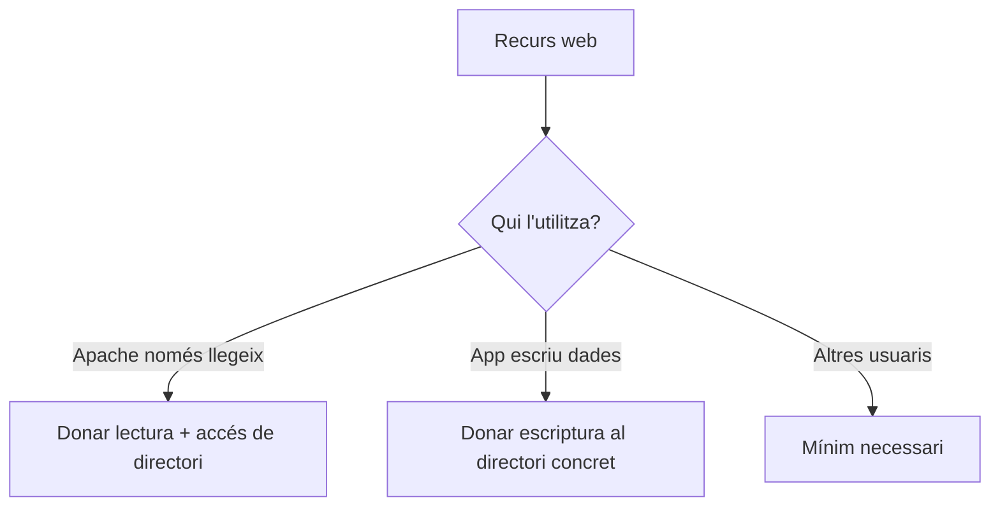

# Bloc 3: Permisos en Linux aplicats al desplegament d'aplicacions web

Aquesta guia no busca memoritzar valors ni receptes. Busca entendre qui pot fer què sobre els fitxers d'una web, i per què.

> **Idea clau**
> Si entens el model de permisos, pots deduir la configuració correcta sense dependre de la memòria.

---

## 1. Per què existeixen els permisos?

Situació real:

> He desplegat la web, Apache està funcionant, però el navegador mostra un error 403 Forbidden.

Pregunta inicial:

- Si els fitxers existeixen, per què Apache no els pot mostrar?

Els permisos existeixen per controlar:

- qui pot accedir a un fitxer o directori
- què hi pot fer (llegir, escriure, executar)

Sense permisos, qualsevol usuari podria modificar o llegir qualsevol fitxer del sistema. Amb permisos, el sistema protegeix dades i evita errors de seguretat.

> **Idea clau**
> En Linux, que un fitxer existeixi no implica que tothom hi pugui accedir.

---

## 2. Qui interactua amb els fitxers?

Actors habituals en un desplegament web:

- desenvolupador
- Apache (normalment usuari del servei web, per exemple `www-data`)
- altres usuaris del sistema

Pregunta:

- Necessiten tots els mateixos permisos?

Resposta curta: no.

- El desenvolupador sol necessitar llegir i modificar codi.
- Apache necessita, en general, llegir els fitxers publicats.
- Altres usuaris no haurien de tenir més permisos dels necessaris.

Esquema:

```text
Fitxers de la web al servidor
        |
  ---------------------------
  |            |            |
Desenvolupador Apache     Altres usuaris
(edita)       (serveix)   (accés limitat)
```

> **Idea clau**
> Donar el mateix permís a tothom simplifica avui, però crea problemes de seguretat demà.

---

## 3. El model de permisos de Linux

Linux separa permisos per a tres tipus d'usuaris:

- propietari
- grup
- altres

I defineix tres tipus de permisos:

- lectura (`r`)
- escriptura (`w`)
- execució (`x`)

Important: el significat canvia una mica si parlem d'un fitxer o d'un directori.

| Permís | En un fitxer | En un directori |
|---|---|---|
| `r` | Pots llegir el contingut | Pots veure què hi ha dins (llistar noms) |
| `w` | Pots modificar el fitxer | Pots crear, esborrar o reanomenar elements |
| `x` | Pots executar-lo com a programa/script | Pots entrar-hi (travessar el directori) |

Exemple de raonament:

- Si Apache ha de servir `index.html`, necessita llegir-lo.
- Si Apache ha d'arribar a `css/styles.css`, necessita poder travessar els directoris del camí.

> **Idea clau**
> En directoris, el permís `x` és tan important com el `r`.

---

## 4. Com interpretar els permisos

Dos exemples habituals:

- `-rw-r--r--`
- `drwxr-xr-x`

Com es llegeix:

1. Primer caràcter:
   - `-` = fitxer
   - `d` = directori
2. Després venen tres blocs de tres caràcters:
   - bloc 1: propietari
   - bloc 2: grup
   - bloc 3: altres

Exemple interpretat:

- `-rw-r--r--`
  - fitxer
  - propietari: llegeix i escriu
  - grup: llegeix
  - altres: llegeix

- `drwxr-xr-x`
  - directori
  - propietari: lectura, escriptura, execució
  - grup: lectura i execució
  - altres: lectura i execució

> **Idea clau**
> No cal memoritzar números per començar: cal saber llegir qui pot fer què.

---

## 5. Aplicació al desplegament

Pregunta guia:

- Quins permisos necessita cada actor perquè la web funcioni, sense obrir massa la porta?

Raonament aplicat:

- Qui necessita llegir els HTML? Apache (i sovint el desenvolupador).
- Qui necessita llegir CSS i JS? Apache.
- Qui necessita executar un directori? Qualsevol actor que hagi de travessar-lo per arribar a fitxers.
- Quan cal escriptura en un directori? Quan l'aplicació genera o modifica fitxers (logs, pujades, cache, etc.).

Mini esquema de decisió:



Situació real de projecte:

- Una zona de pujada d'imatges pot necessitar escriptura.
- El codi font de la web, en general, no hauria de ser modificable per qualsevol usuari.

> **Idea clau**
> Els permisos es decideixen per necessitat funcional, no per comoditat temporal.

---

## 6. Les ordres mínimes

No cal un manual complet. Comença per consultar permisos, ajustar la propietat i comprovar els grups de l'usuari.

### `ls -l`

Serveix per veure propietari, grup i permisos d'arxius/directoris.

```bash
ls -l
```

### `chmod`

Serveix per canviar permisos.

```bash
chmod ... fitxer_o_directori
```

Quina idea has de retenir:

- `chmod` canvia "què es pot fer" sobre el recurs.

### `chown`

Serveix per canviar propietari i/o grup.

```bash
chown ... fitxer_o_directori
```

Quina idea has de retenir:

- `chown` canvia "qui és el responsable" del recurs.

> **Idea clau**
> `ls -l` diagnostica, `chmod` ajusta permisos, `chown` ajusta propietat.

### `id` i `usermod`: comprovar i modificar els grups d'un usuari

Canviar el grup d'un fitxer no és el mateix que afegir un usuari a un grup:

- `chown usuari:grup ruta` canvia el propietari i el grup del recurs.
- `sudo usermod -aG grup usuari` afegeix l'usuari a un grup suplementari.
- `id usuari` mostra els grups als quals pertany aquest usuari.

Per exemple, al servidor:

```bash
id devop
sudo usermod -aG desplegament devop
id devop
```

El grup `devop` ha d'existir. L'opció `-a` vol dir afegir: amb `-G` sense `-a` substituiries la llista de grups suplementaris. Normalment no cal canviar el grup principal de l'usuari.

Després del canvi, tanca la sessió SSH i obre'n una de nova perquè incorpori els grups actualitzats. Executa `id` dins la nova sessió per comprovar els grups efectius. Si reutilitzes connexions SSH persistents, també cal renovar-les.

> **Idea clau**
> Quan executes `rsync` sobre SSH, qui escriu al servidor és l'usuari de `usuari@servidor`. Els seus grups i permisos al servidor determinen si pot desplegar.

### 6.1. Exemple de configuració habitual per desplegar amb rsync

No hi ha una configuració única per a totes les aplicacions. Aquesta és una base senzilla per publicar **fitxers estàtics públics**, com HTML, CSS, JavaScript i imatges, en un servidor Debian/Ubuntu amb Apache:

- `devop` és un compte existent que es connecta per SSH i envia fitxers amb rsync.
- `desplegament` és el grup que pot modificar els fitxers publicats.
- Apache s'executa amb l'usuari `www-data` i només necessita llegir aquests fitxers.
- `/var/www/exemple/public` és el directori publicat, dedicat a aquesta web.

#### Pas 1: preparar el grup al servidor

Un administrador executa aquestes ordres al servidor, creant el grup només si encara no existeix:

```bash
sudo groupadd -f desplegament
sudo usermod -aG desplegament devop
```

No afegim Apache al grup `desplegament`, perquè aquest grup tindrà permís per modificar el codi publicat.

#### Pas 2: preparar el directori i els permisos

Al servidor, per a aquest directori dedicat de contingut estàtic:

```bash
sudo mkdir -p /var/www/exemple/public
sudo chown -R devop:desplegament /var/www/exemple/public
sudo find /var/www/exemple/public -type d -exec chmod 2775 {} +
sudo find /var/www/exemple/public -type f -exec chmod 664 {} +
```

Què aconseguim:

| Recurs | Permisos | Propietari i grup | Altres usuaris, inclòs Apache |
|---|---|---|---|
| Directoris | `2775` (`rwxrwsr-x`) | Poden llistar, travessar i modificar el contingut | Poden llistar i travessar |
| Fitxers estàtics | `664` (`rw-rw-r--`) | Poden llegir i escriure | Poden llegir |

El `2` inicial activa **setgid** als directoris: els elements nous hereten el grup del directori pare. Això manté el grup `desplegament` encara que no sigui el grup principal de l'usuari. Setgid no dona per si sol escriptura al grup; també cal ajustar els permisos dels elements nous.

En aquest exemple `devop` pot escriure perquè és el propietari. La pertinença a `desplegament` també li permet treballar en directoris d'aquest grup que pertanyin a un altre usuari i tinguin permisos de grup adequats.

Apache i l'usuari de desplegament han de poder travessar tots els directoris pare, inclosos `/var`, `/var/www` i `/var/www/exemple`. Pots inspeccionar el camí complet amb:

```bash
namei -l /var/www/exemple/public
```

Aquesta configuració permet lectura als altres usuaris locals perquè el contingut és públic. Els secrets, com `.env`, claus o credencials, han de quedar fora d'aquest directori i tenir permisos específics.

#### Pas 3: desplegar des de l'ordinador local

Després de renovar la connexió SSH, executa al teu ordinador:

```bash
rsync -av --no-owner --no-group --chmod=D2775,F664 ./public/ devop@servidor:/var/www/exemple/public/
```

- `./public/` indica que envies el contingut de la carpeta local de fitxers públics.
- `--no-owner --no-group` evita intentar conservar els propietaris i grups de l'ordinador local. Al servidor, els fitxers nous pertanyen a `devop` i hereten el grup del directori amb setgid.
- `--chmod=D2775,F664` fixa els permisos de directoris i fitxers del destí segons el model anterior. Així, els permisos locals no deixen Apache sense lectura ni el grup sense escriptura.

Rsync ha d'estar instal·lat als dos equips. No cal executar-lo amb `sudo`: el compte remot ja té els permisos necessaris. Aquesta ordre no elimina fitxers sobrants al destí.

#### Pas 4: comprovar el resultat al servidor

En una sessió SSH nova de `devop`:

```bash
id
ls -ld /var/www/exemple/public
ls -l /var/www/exemple/public
test -w /var/www/exemple/public && echo "L'usuari pot escriure al directori"
```

Un administrador pot comprovar que Apache llegeix un fitxer desplegat:

```bash
sudo -u www-data test -r /var/www/exemple/public/index.html && echo "Apache pot llegir index.html"
```

Perquè la web es mostri, el lloc d'Apache també ha de tenir el `DocumentRoot` apuntant a `/var/www/exemple/public` i permetre l'accés a aquest directori en la seva configuració. Uns permisos Linux correctes no substitueixen aquesta configuració.

Si l'aplicació necessita escriure a `uploads/` o `cache/`, dona permisos a l'usuari que executa l'aplicació només en aquests directoris. Mantén aquestes dades fora de la sincronització del codi. No cal donar escriptura a Apache sobre tota la web ni afegir-lo al grup de desplegament.

> **Idea clau**
> Una base coherent combina usuari remot autoritzat, grup correcte, directoris que hereten el grup i permisos de rsync compatibles amb la lectura d'Apache.

---

## 7. Errors habituals

### Cas 1: Apache retorna 403

- Què significa: el servidor troba el recurs però no hi pot accedir.
- Possible causa: falta permís de lectura al fitxer o execució en algun directori del camí.
- Primer que comprovaria: permisos i propietari del camí complet fins al fitxer.

### Cas 2: `rsync` copia fitxers però la web no funciona

- Què significa: la transferència ha anat bé, però Apache no pot servir correctament algun recurs.
- Possible causa: permisos finals no adequats després de sincronitzar.
- Primer que comprovaria: permisos/propietari dels fitxers desplegats i de directoris clau.

### Cas 3: El desenvolupador no pot modificar fitxers

- Què significa: no tens permisos d'escriptura on necessites treballar.
- Possible causa: propietari o grup incorrecte.
- Primer que comprovaria: propietari/grup actual i permís d'escriptura del teu usuari.

### Cas 4: Un directori no permet accedir al seu contingut

- Què significa: no pots "entrar" al directori encara que el fitxer final existeixi.
- Possible causa: falta permís d'execució (`x`) al directori.
- Primer que comprovaria: permís del directori, no només del fitxer.

### Cas 5: He afegit l'usuari al grup, però rsync encara diu `Permission denied`

- Possible causa: la connexió SSH encara utilitza els grups de la sessió anterior, o el directori no té el grup o els permisos esperats.
- Primer que comprovaria: `id` en una connexió SSH nova i `ls -ld /ruta/desti` al servidor.
- Per crear, substituir o eliminar fitxers, l'usuari necessita escriptura i execució sobre el directori corresponent. Pertànyer al grup no serveix si aquest grup no té els permisos necessaris.

> **Idea clau**
> Molts errors de desplegament no són de codi, són de permisos i propietat.

---

## 8. Bones pràctiques

- Evitar permisos 777.
  - Perquè: obre massa l'accés i incrementa risc de seguretat.
- Donar només els permisos necessaris.
  - Perquè: redueix superfície d'error i atac.
- Diferenciar propietari funcional i servidor web.
  - Perquè: facilita manteniment i evita bloquejos entre usuaris.
- Revisar permisos després de desplegar.
  - Perquè: rsync, còpies o canvis manuals poden deixar estats inesperats.
- Documentar criteris de permisos del projecte.
  - Perquè: permet consistència entre membres de l'equip.

> **Idea clau**
> Seguretat i operativitat no s'oposen: es construeixen amb permisos ben pensats.

---

## 9. Resum visual

### Model base

```text
Permisos Linux = Qui + Què

Qui?
- Propietari
- Grup
- Altres

Què?
- r: llegir
- w: escriure
- x: executar / travessar directori
```

### Significat de r, w, x

| Element | r | w | x |
|---|---|---|---|
| Fitxer | llegir contingut | modificar contingut | executar fitxer |
| Directori | veure contingut | crear/esborrar/reanomenar | entrar/travessar |

### Permisos habituals en projecte web (sense numèrics)

| Recurs | Necessitat habitual Apache | Necessitat habitual desenvolupador |
|---|---|---|
| HTML/CSS/JS | lectura | lectura + escriptura (segons flux) |
| Directoris de codi | travessar + lectura | travessar + lectura + escriptura |
| Directori `uploads/` o `cache/` | escriptura (si app genera fitxers) | controlat segons equip |

### Errors freqüents i possible causa

| Símptoma | Possible causa principal |
|---|---|
| 403 Forbidden | permisos insuficients en fitxer/directori |
| Web parcial (sense CSS/JS) | alguns recursos no llegibles |
| No es poden pujar fitxers | directori sense escriptura per qui toca |

### Idees clau que has de recordar

1. Els permisos existeixen per controlar accés i protegir el sistema.
2. Fitxer i directori no interpreten igual `r`, `w`, `x`.
3. Apache normalment ha de llegir, no editar.
4. Sense `x` en un directori, no es pot arribar als fitxers interns.
5. Primer diagnostica amb `ls -l` abans de tocar res.
6. `chmod` canvia què es pot fer; `chown` canvia qui ho controla.
7. Evita permisos oberts per defecte.
8. Dona només el mínim necessari per funcionar.
9. Molts errors de desplegament són de permisos, no de codi.
10. Si pots justificar un permís, ja tens model mental.
11. `usermod -aG` afegeix l'usuari a un grup; després cal renovar la sessió SSH.
12. Setgid manté el grup dels elements nous; els permisos de rsync han de mantenir els accessos necessaris.
