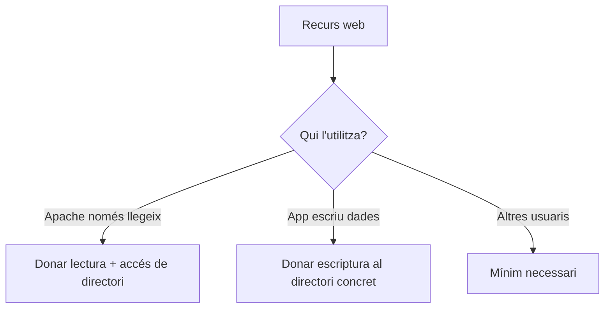

# Bloc 3: Permisos en Linux aplicats al desplegament d'aplicacions web

Aquesta guia no busca memoritzar valors ni receptes. Busca entendre qui pot fer què sobre els fitxers d'una web, i per què.

> **Idea clau**
> Si entens el model de permisos, pots deduir la configuració correcta sense dependre de la memòria.

---

## 1. Per què existeixen els permisos?

Situació real:

> He desplegat la web, Apache està funcionant, però el navegador mostra un error 403 Forbidden.

Pregunta inicial:

- Si els fitxers existeixen, per què Apache no els pot mostrar?

Els permisos existeixen per controlar:

- qui pot accedir a un fitxer o directori
- què hi pot fer (llegir, escriure, executar)

Sense permisos, qualsevol usuari podria modificar o llegir qualsevol fitxer del sistema. Amb permisos, el sistema protegeix dades i evita errors de seguretat.

> **Idea clau**
> En Linux, que un fitxer existeixi no implica que tothom hi pugui accedir.

---

## 2. Qui interactua amb els fitxers?

Actors habituals en un desplegament web:

- desenvolupador
- Apache (normalment usuari del servei web, per exemple `www-data`)
- altres usuaris del sistema

Pregunta:

- Necessiten tots els mateixos permisos?

Resposta curta: no.

- El desenvolupador sol necessitar llegir i modificar codi.
- Apache necessita, en general, llegir els fitxers publicats.
- Altres usuaris no haurien de tenir més permisos dels necessaris.

Esquema:

```text
Fitxers de la web al servidor
        |
  ---------------------------
  |            |            |
Desenvolupador Apache     Altres usuaris
(edita)       (serveix)   (accés limitat)
```

> **Idea clau**
> Donar el mateix permís a tothom simplifica avui, però crea problemes de seguretat demà.

---

## 3. El model de permisos de Linux

Linux separa permisos per a tres tipus d'usuaris:

- propietari
- grup
- altres

I defineix tres tipus de permisos:

- lectura (`r`)
- escriptura (`w`)
- execució (`x`)

Important: el significat canvia una mica si parlem d'un fitxer o d'un directori.

| Permís | En un fitxer | En un directori |
|---|---|---|
| `r` | Pots llegir el contingut | Pots veure què hi ha dins (llistar noms) |
| `w` | Pots modificar el fitxer | Pots crear, esborrar o reanomenar elements |
| `x` | Pots executar-lo com a programa/script | Pots entrar-hi (traversar el directori) |

Exemple de raonament:

- Si Apache ha de servir `index.html`, necessita llegir-lo.
- Si Apache ha d'arribar a `css/styles.css`, necessita poder traversar els directoris del camí.

> **Idea clau**
> En directoris, el permís `x` és tan important com el `r`.

---

## 4. Com interpretar els permisos

Dos exemples habituals:

- `-rw-r--r--`
- `drwxr-xr-x`

Com es llegeix:

1. Primer caràcter:
   - `-` = fitxer
   - `d` = directori
2. Després venen tres blocs de tres caràcters:
   - bloc 1: propietari
   - bloc 2: grup
   - bloc 3: altres

Exemple interpretat:

- `-rw-r--r--`
  - fitxer
  - propietari: llegeix i escriu
  - grup: llegeix
  - altres: llegeix

- `drwxr-xr-x`
  - directori
  - propietari: lectura, escriptura, execució
  - grup: lectura i execució
  - altres: lectura i execució

> **Idea clau**
> No cal memoritzar números per començar: cal saber llegir qui pot fer què.

---

## 5. Aplicació al desplegament

Pregunta guia:

- Quins permisos necessita cada actor perquè la web funcioni, sense obrir massa la porta?

Raonament aplicat:

- Qui necessita llegir els HTML? Apache (i sovint el desenvolupador).
- Qui necessita llegir CSS i JS? Apache.
- Qui necessita executar un directori? Qualsevol actor que hagi de travessar-lo per arribar a fitxers.
- Quan cal escriptura en un directori? Quan l'aplicació genera o modifica fitxers (logs, pujades, cache, etc.).

Mini esquema de decisió:



Situació real de projecte:

- Una zona de pujada d'imatges pot necessitar escriptura.
- El codi font de la web, en general, no hauria de ser modificable per qualsevol usuari.

> **Idea clau**
> Els permisos es decideixen per necessitat funcional, no per comoditat temporal.

---

## 6. Les ordres mínimes

No cal un manual complet. Amb tres comandes ben enteses tens gran part del control inicial.

### `ls -l`

Serveix per veure propietari, grup i permisos d'arxius/directoris.

```bash
ls -l
```

### `chmod`

Serveix per canviar permisos.

```bash
chmod ... fitxer_o_directori
```

Quina idea has de retenir:

- `chmod` canvia "què es pot fer" sobre el recurs.

### `chown`

Serveix per canviar propietari i/o grup.

```bash
chown ... fitxer_o_directori
```

Quina idea has de retenir:

- `chown` canvia "qui és el responsable" del recurs.

> **Idea clau**
> `ls -l` diagnostica, `chmod` ajusta permisos, `chown` ajusta propietat.

---

## 7. Errors habituals

### Cas 1: Apache retorna 403

- Què significa: el servidor troba el recurs però no hi pot accedir.
- Possible causa: falta permís de lectura al fitxer o execució en algun directori del camí.
- Primer que comprovaria: permisos i propietari del camí complet fins al fitxer.

### Cas 2: `rsync` copia fitxers però la web no funciona

- Què significa: la transferència ha anat bé, però Apache no pot servir correctament algun recurs.
- Possible causa: permisos finals no adequats després de sincronitzar.
- Primer que comprovaria: permisos/propietari dels fitxers desplegats i de directoris clau.

### Cas 3: El desenvolupador no pot modificar fitxers

- Què significa: no tens permisos d'escriptura on necessites treballar.
- Possible causa: propietari o grup incorrecte.
- Primer que comprovaria: propietari/grup actual i permís d'escriptura del teu usuari.

### Cas 4: Un directori no permet accedir al seu contingut

- Què significa: no pots "entrar" al directori encara que el fitxer final existeixi.
- Possible causa: falta permís d'execució (`x`) al directori.
- Primer que comprovaria: permís del directori, no només del fitxer.

> **Idea clau**
> Molts errors de desplegament no són de codi, són de permisos i propietat.

---

## 8. Bones pràctiques

- Evitar permisos 777.
  - Perquè: obre massa l'accés i incrementa risc de seguretat.
- Donar només els permisos necessaris.
  - Perquè: redueix superfície d'error i atac.
- Diferenciar propietari funcional i servidor web.
  - Perquè: facilita manteniment i evita bloquejos entre usuaris.
- Revisar permisos després de desplegar.
  - Perquè: rsync, còpies o canvis manuals poden deixar estats inesperats.
- Documentar criteris de permisos del projecte.
  - Perquè: permet consistència entre membres de l'equip.

> **Idea clau**
> Seguretat i operativitat no s'oposen: es construeixen amb permisos ben pensats.

---

## 9. Preguntes per construir el coneixement

1. Si Apache només ha de llegir un fitxer, necessita permís d'escriptura?
2. Per què un directori necessita permís d'execució per poder-hi accedir?
3. Què passaria si tots els usuaris poguessin modificar els fitxers de la web?
4. Qui hauria de ser el propietari dels fitxers després del desplegament?
5. Per què donar més permisos dels necessaris és una mala pràctica?
6. Per què pot funcionar `index.html` però fallar `styles.css`?
7. Quina diferència hi ha entre permís insuficient en fitxer i en directori?
8. Si tens 403, quin recorregut faries per diagnosticar-lo?
9. Quins directoris poden requerir escriptura real en una aplicació web?
10. Si rsync ha anat bé, per què encara pot fallar la web?
11. Què et diu la sortida de `ls -l` sobre responsabilitat i risc?
12. Quan és millor canviar propietari i quan és millor ajustar grup?
13. Com afecta al teu flux de treball no tenir permisos d'escriptura al projecte remot?
14. Quina decisió de permisos prioritzaries en un equip de 3 desenvolupadors?

---

## 10. Activitat guiada (20-30 minuts)

Objectiu:

- deduir permisos necessaris des del raonament funcional, no des de la memòria.

### Material (cas pràctic)

Tens aquesta estructura al servidor:

```text
/var/www/projecte
  index.html
  css/styles.css
  js/app.js
  uploads/
```

I aquestes observacions:

- `index.html` carrega.
- `styles.css` dona error 403.
- El formulari de pujada no pot guardar fitxers a `uploads/`.

### Tasca per equips (2-3 alumnes)

1. Identifiqueu actors: desenvolupador, Apache, altres.
2. Deduïu quins permisos necessita cada recurs per funcionar.
3. Determineu si hi ha problema de seguretat en algun directori.
4. Proposeu canvis de permisos i/o propietat i justifiqueu-los.
5. Definiu quina comprovació faríeu primer amb `ls -l`.

### Producte final (1 pàgina)

- Taula amb recurs -> actor -> permís necessari -> risc si és massa permissiu.
- Hipòtesi del problema principal.
- Canvi proposat i justificació.

### Criteri d'avaluació ràpida

- Distingir fitxer vs directori correctament.
- Relacionar permisos amb funció real de cada actor.
- Prioritzar mínim permís necessari.

> **Idea clau**
> Si pots justificar "per què" d'un permís, no depens de receptes.

---

## 11. Resum visual

### Model base

```text
Permisos Linux = Qui + Què

Qui?
- Propietari
- Grup
- Altres

Què?
- r: llegir
- w: escriure
- x: executar / travessar directori
```

### Significat de r, w, x

| Element | r | w | x |
|---|---|---|---|
| Fitxer | llegir contingut | modificar contingut | executar fitxer |
| Directori | veure contingut | crear/esborrar/reanomenar | entrar/travessar |

### Permisos habituals en projecte web (sense numèrics)

| Recurs | Necessitat habitual Apache | Necessitat habitual desenvolupador |
|---|---|---|
| HTML/CSS/JS | lectura | lectura + escriptura (segons flux) |
| Directoris de codi | travessar + lectura | travessar + lectura + escriptura |
| Directori `uploads/` o `cache/` | escriptura (si app genera fitxers) | controlat segons equip |

### Errors freqüents i possible causa

| Símptoma | Possible causa principal |
|---|---|
| 403 Forbidden | permisos insuficients en fitxer/directori |
| Web parcial (sense CSS/JS) | alguns recursos no llegibles |
| No es poden pujar fitxers | directori sense escriptura per qui toca |

### Idees clau que has de recordar

1. Els permisos existeixen per controlar accés i protegir el sistema.
2. Fitxer i directori no interpreten igual `r`, `w`, `x`.
3. Apache normalment ha de llegir, no editar.
4. Sense `x` en un directori, no es pot arribar als fitxers interns.
5. Primer diagnostica amb `ls -l` abans de tocar res.
6. `chmod` canvia què es pot fer; `chown` canvia qui ho controla.
7. Evita permisos oberts per defecte.
8. Dona només el mínim necessari per funcionar.
9. Molts errors de desplegament són de permisos, no de codi.
10. Si pots justificar un permís, ja tens model mental.
