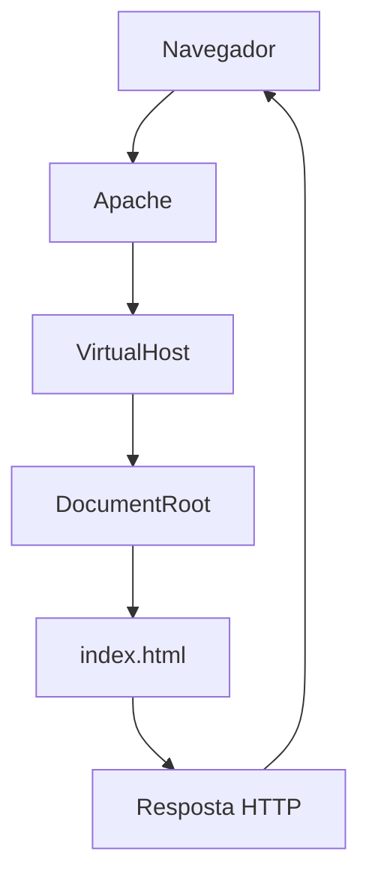
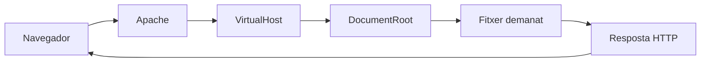

# Bloc 4: Apache mínim - servir una aplicació web

Aquesta guia no és un manual complet d'Apache. És una base mental clara per entendre quin paper té Apache en el desplegament i com configurar un lloc senzill sabent què estàs fent.

> **Idea clau**
> Apache no crea la teva web: la publica i la serveix quan un navegador la demana.

---

## 1. Quin problema resol Apache?

Situació real:

> Els fitxers HTML ja són al servidor. Per què encara no puc veure la web des del navegador?

Pregunta inicial:

- Qui envia els fitxers al navegador?

Apache és un servidor web. La seva feina principal és:

- escoltar peticions HTTP
- decidir quina web toca servir
- retornar els fitxers adequats

Sense Apache (o un altre servidor web, per exemple Nginx), els fitxers poden existir al servidor, però no hi ha cap servei que els lliuri al navegador.

Esquema:

```text
Navegador demana /index.html
          |
          v
       Apache
          |
   busca el fitxer
          |
          v
retorna resposta HTTP
```

> **Idea clau**
> Fitxers al servidor no vol dir web publicada: cal un servidor web que respongui peticions.

---

## 2. El recorregut d'una petició

Abans de configurar, entenem el flux:

Navegador
↓
Apache
↓
VirtualHost
↓
DocumentRoot
↓
index.html
↓
Resposta al navegador

Què fa cada element:

- Navegador: demana una URL.
- Apache: rep la petició i decideix quina configuració aplicar.
- VirtualHost: defineix "aquesta URL correspon a aquesta web" ( nom de domini i carpeta). Permet que un mateix servidor tingui diverses webs.
- DocumentRoot: carpeta base de la web. És on Apache busca fitxers per servir.
- index.html (o altres recursos): fitxer concret que cal servir.
- Resposta: codi i contingut que torna al navegador.



> **Idea clau**
> Apache no endevina la web: la determina amb la configuració del VirtualHost.

---

## 3. Què és un VirtualHost?

Preguntes inicials:

- Com pot un mateix servidor allotjar diverses pàgines web?
- Com sap Apache quina web ha de servir?

Un VirtualHost és una configuració que relaciona:

- un nom de domini (o host)
- una carpeta de fitxers
- unes regles mínimes d'accés

Esquema conceptual:

```text
Servidor Apache
  |- VirtualHost A -> escola.cat -> /var/www/escola
  |- VirtualHost B -> botiga.cat -> /var/www/botiga
```

Situació real de projecte:

- El mateix servidor pot tenir entorn de proves i web final, cadascun amb el seu VirtualHost.

> **Idea clau**
> VirtualHost = "aquesta adreça ha de servir aquesta carpeta".

---

## 4. Què és el DocumentRoot?

DocumentRoot és la carpeta des d'on Apache serveix fitxers d'una web.

Relació amb el model mental anterior:

- Tu desplegues fitxers al servidor.
- Apache només serveix els fitxers que queden sota el DocumentRoot configurat.

Pregunta:

- Què passa si el DocumentRoot apunta a una carpeta equivocada?

Conseqüències habituals:

- es veu una web que no toca
- error 404 per fitxers que "sí existeixen" en una altra carpeta
- apareix la pàgina per defecte d'Apache

Exemple simple:

- Correcte: `/var/www/projecte/public`
- Incorrecte: `/var/www/projecte` (si `index.html` està dins `public`)

> **Idea clau**
> Si DocumentRoot no apunta on toca, Apache serveix una realitat diferent de la teva intenció.

---

## 5. La configuració mínima

Ara sí: configuració mínima, comentada per entendre el "per què".

```apache
<VirtualHost *:80>
    ServerName projecte.local
    DocumentRoot /var/www/projecte/public

    <Directory /var/www/projecte/public>
        AllowOverride None
        Require all granted
    </Directory>
</VirtualHost>
```

Línia per línia:

- `ServerName`: nom de host o adreça IP que identifica aquest lloc. Si hi ha diverses webs a la mateixa IP i port, Apache compara el nom que demana el navegador (capçalera HTTP `Host`) amb el `ServerName` i els possibles `ServerAlias` per triar el VirtualHost.

  **És obligatori?** No és imprescindible per arrencar Apache, però convé indicar-lo explícitament a cada VirtualHost. Si l'ometem, Apache intenta deduir un nom a partir de la configuració i del sistema. Si no pot determinar el nom del servidor, pot mostrar l'avís `Could not reliably determine the server's fully qualified domain name`, que per si sol no impedeix l'arrencada. El `ServerName` global, fora dels blocs VirtualHost, es configura separadament dels noms de cada lloc.

  **Quina web es mostra si no coincideix cap nom?** Apache serveix el primer VirtualHost carregat dels que corresponen a la IP i el port de la petició. Per això, accedir per IP pot mostrar la pàgina per defecte d'Apache en lloc del nostre projecte. Ometre `ServerName` no converteix automàticament aquell lloc en el predeterminat. Pots veure l'ordre i els llocs predeterminats amb `apachectl -S`.

  **Què posem segons el cas?** En aquest exemple HTTP al port 80:

  | Situació | Línia de configuració | Adreça al navegador |
  |---|---|---|
  | Tenim un domini que apunta al servidor | `ServerName exemple.cat` | `http://exemple.cat` |
  | No tenim domini i accedim per la IP del servidor | `ServerName 192.168.1.50` | `http://192.168.1.50` |
  | Fem proves al mateix ordinador on funciona Apache | `ServerName localhost` | `http://localhost` |
  | Volem un nom de proves sense comprar un domini | `ServerName projecte.test` | `http://projecte.test` |

  Substitueix `192.168.1.50` per la IP real accessible del servidor. `localhost` sempre fa referència a l'ordinador des del qual obres el navegador: no serveix per identificar un servidor remot.

  Per utilitzar un nom de proves, afegeix una entrada com `192.168.1.50 projecte.test` al fitxer `hosts` de l'ordinador **on obres el navegador** (`/etc/hosts` a Linux; `C:\Windows\System32\drivers\etc\hosts` a Windows). Si Apache és al mateix ordinador, utilitza `127.0.0.1`. El nom ha de coincidir amb el `ServerName`. El `projecte.local` de l'exemple també necessita resolució de noms; per a proves manuals és preferible utilitzar `.test`, ja que `.local` s'utilitza per a mDNS.

  Escriure `ServerName` no crea un domini ni configura el DNS o la IP del servidor: només indica a Apache com identificar el lloc. Referència: [selecció de VirtualHosts per nom](https://httpd.apache.org/docs/2.4/vhosts/name-based.html) i [directiva ServerName](https://httpd.apache.org/docs/2.4/mod/core.html#servername).

- `DocumentRoot`: carpeta base des d'on es serviran fitxers.
- `<Directory ...>`: regles que s'apliquen a aquella carpeta.
- `AllowOverride`: permet o no que `.htaccess` canviï comportament.
  - En aquesta fase, pensa-ho com "de moment no deleguem canvis en .htaccess".
- `Require all granted`: autoritza l'accés web a aquella carpeta.

> **Idea clau**
> Configuració mínima = identificar web, carpeta i permisos d'accés web.

---

## 6. Activar el lloc

Concepte abans de comandes:

- Habilitar un lloc: dir a Apache que una configuració de VirtualHost ha d'entrar en funcionament.
- Recarregar Apache: aplicar canvis sense aturar completament el servei.
- Reiniciar Apache: parar i arrencar el servei de nou.

Ordres imprescindibles:

```bash
a2ensite nom-del-lloc.conf
systemctl reload apache2
systemctl restart apache2
```

Què fa cadascuna:

- `a2ensite`: habilita un fitxer de lloc (Virtualhost).
- `reload`: rellegeix configuració activa amb impacte mínim. Quan es fa un canvi en un fitxer de VirtualHost. s'ha de recarregar perquè Apache l'apliqui.
- `restart`: reinicia el servei complet.

Quan usar cada una:

- Després d'habilitar/modificar configuració: primer `reload` si és possible.
- Si hi ha comportament estrany o canvis que no s'apliquen: `restart`.

> **Idea clau**
> No n'hi ha prou amb editar fitxers: cal aplicar canvis al servei.

---

## 7. Errors habituals

No vagis directe a "tocar coses". Primer interpreta.

| Situació | Què significa | Possible causa | Primera comprovació |
|---|---|---|---|
| Apache funciona però es veu la pàgina per defecte | El lloc esperat no és el que s'està servint | VirtualHost no habilitat o ServerName no coincideix | Comprovar lloc habilitat i `ServerName` |
| Error 403 | Apache troba la ruta però no hi pot accedir | Permisos o regles de directori | Revisar permisos i `Require all granted` |
| Error 404 | El recurs demanat no es troba | Ruta mal definida, DocumentRoot incorrecte | Verificar ruta del fitxer i DocumentRoot |
| Apache no arrenca | El servei no pot iniciar-se | Error de sintaxi/configuració | Comprovar estat del servei i configtest |
| El navegador no connecta | No hi ha resposta HTTP del servidor | Servei caigut, port no escoltant, host incorrecte | Verificar estat d'Apache i URL usada |

> **Idea clau**
> Cada error et diu "on mirar primer". Diagnosticar bé és més important que provar a cegues.

---

## 8. On buscar informació quan alguna cosa falla?

Objectiu: tenir un mètode de diagnosi repetible.

### `systemctl status apache2`

- Què comprova: si Apache està actiu, aturat o en error.
- Quan usar-lo: sempre que sospitis que el servei no respon.

### `apachectl configtest`

- Què comprova: sintaxi i coherència bàsica de configuració.
- Quan usar-lo: abans de recarregar/reiniciar després de canvis.

### `error.log`

- Què comprova: errors interns d'Apache i de configuració.
- Quan usar-lo: quan tens 403, 500 o el servei no arrenca.

### `access.log`

- Què comprova: peticions rebudes i codis de resposta.
- Quan usar-lo: per veure si la petició arriba i quin resultat dona (200, 403, 404...).

> **Idea clau**
> Estat + configtest + logs = trident mínim de diagnosi.

---

## 9. Bones pràctiques

- Mantenir configuració senzilla.
  - Perquè: facilita entendre i depurar.
- Un VirtualHost per projecte.
  - Perquè: evita barreges de dominis i rutes.
- Documentar canvis (què, quan, per què).
  - Perquè: evita repetir errors i ajuda l'equip.
- No modificar fitxers sense entendre'ls.
  - Perquè: "provar a cegues" crea errors encadenats.

> **Idea clau**
> En desplegament, simplicitat i traçabilitat valen més que solucions ràpides improvisades.

---

## 10. Resum visual

### Paper d'Apache en el desplegament

```text
Codi desplegat al servidor
        +
Configuració Apache correcta
        =
Web accessible des del navegador
```

### Esquema complet d'una petició



### Relació entre VirtualHost i DocumentRoot

| Concepte | Pregunta que resol |
|---|---|
| VirtualHost | "Quina web toca servir per aquest domini?" |
| DocumentRoot | "Des de quina carpeta surt aquesta web?" |

### Ordres imprescindibles

| Ordre | Per a què serveix |
|---|---|
| `a2ensite` | Habilitar un lloc |
| `systemctl reload apache2` | Aplicar canvis sense parada completa |
| `systemctl restart apache2` | Reiniciar servei complet |

### Errors habituals i primera comprovació

| Error/Símptoma | Primera comprovació |
|---|---|
| Pàgina per defecte d'Apache | VirtualHost habilitat i `ServerName` |
| 403 | Permisos i regles de directori |
| 404 | Ruta del recurs i DocumentRoot |
| Apache no arrenca | `apachectl configtest` + `systemctl status` |
| No hi ha connexió | Estat del servei i URL usada |

### Idees clau que has de recordar

1. Apache és qui serveix la web al navegador.
2. VirtualHost decideix quina web toca.
3. DocumentRoot decideix des d'on es serveix.
4. Configurar no és suficient: cal aplicar canvis (`reload` o `restart`).
5. 403, 404 i pàgina per defecte donen pistes diferents.
6. Diagnostica amb mètode: estat -> configtest -> logs.
7. Una configuració simple és més fàcil de mantenir.
8. No toquis directives que no entens.
9. El desplegament combina codi, permisos i servidor web.
10. Entendre el flux et permet deduir solucions sense memoritzar manuals.
