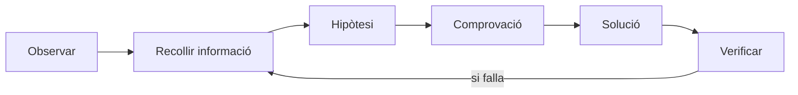

# Bloc 5: Diagnòstic i resolució d'errors en un desplegament web

Aquest bloc no tracta de memoritzar receptes. Tracta de pensar com un professional quan alguna cosa falla.

> **Idea clau**
> Diagnosticar bé és reduir incertesa amb evidències, no provar ordres a l'atzar.

---

## 1. La mentalitat del diagnòstic

Situació real:

> He desplegat una aplicació, però no funciona. Què faig ara?

Un administrador no improvisa. Segueix un procés.

Metodologia mínima:

1. Observar el problema.
2. Recollir informació.
3. Formular una hipòtesi.
4. Fer una comprovació.
5. Aplicar una solució.
6. Tornar a verificar.



> **Idea clau**
> Si no formules hipòtesi, no estàs diagnosticant: estàs provant sort.

---

## 2. El model de capes del desplegament

Quan una web falla, primer pregunta: en quina capa pot estar el problema?

```text
Usuari / navegador
        ↓
Xarxa
        ↓
Servidor Linux
        ↓
Apache
        ↓
Fitxers
        ↓
Aplicació
        ↓
Base de dades (si existeix)
```

Exemples ràpids:

- No hi ha connexió -> xarxa o servidor.
- Apache no respon -> servei web.
- Error 403 -> permisos o accés.
- Error 500 -> aplicació o configuració interna.

> **Idea clau**
> Localitzar la capa correcta és mitja diagnosi feta.

---

## 3. Els primers passos quan alguna cosa falla

Abans de tocar res, segueix una seqüència lògica.

Preguntes inicials:

- El servidor està encès?
- Puc connectar-me per SSH?
- Apache està funcionant?
- Els fitxers existeixen on toca?
- Els permisos són correctes?

Seqüència recomanada:

```text
1) Confirmar símptoma
2) Confirmar connectivitat
3) Confirmar estat d'Apache
4) Confirmar configuració activa
5) Confirmar fitxers i permisos
6) Confirmar comportament de l'aplicació
```

> **Idea clau**
> De fora cap a dins: primer servei i infraestructura, després app.

---

## 4. Diagnòstic d'errors HTTP

### Error 403 Forbidden

- Què significa: el servidor troba el recurs, però no pot servir-lo.
- Relació habitual: permisos de fitxer/directori o restriccions d'accés.
- Possibles causes: directori sense accés, fitxer no llegible, regla de directori massa restrictiva.
- Primera comprovació: permisos i propietari del camí complet.

### Error 404 Not Found

- Què significa: el recurs demanat no existeix en la ruta que Apache està servint.
- Relació habitual: rutes incorrectes o DocumentRoot mal apuntat.
- Possibles causes: fitxer no pujat, nom mal escrit, carpeta equivocada.
- Primera comprovació: ruta exacta i DocumentRoot.

### Error 500 Internal Server Error

- Què significa: error intern en processar la petició.
- Relació habitual: error d'aplicació, configuració o permisos en components interns.
- Possibles causes: codi amb excepció, config invàlida, dependències absents.
- Primera comprovació: logs d'error i últim canvi fet.

| Error | Significat | Primera cosa a comprovar |
|---|---|---|
| 403 | El recurs existeix però no és accessible | Permisos i accés de directori |
| 404 | El recurs no es troba en la ruta servida | Ruta i DocumentRoot |
| 500 | Error intern en processar la petició | error.log i canvis recents |

> **Idea clau**
> El codi HTTP no et dona tota la solució, però sí la direcció correcta.

---

## 5. Els logs: escoltar què diu el servidor

Els logs no són l'últim recurs. Són una font principal de diagnosi.

### access.log

- Què guarda: peticions rebudes (URL, codi HTTP, agent, etc.).
- Quan mirar-lo: per confirmar si la petició arriba i què retorna.
- Què et pot dir: si el problema és recurrent, quina ruta falla, amb quin codi.

Exemple simple:

```text
GET /css/styles.css 404
```

Interpretació: el navegador demana aquest fitxer i Apache no el troba.

### error.log

- Què guarda: errors interns del servidor web i de la capa d'app.
- Quan mirar-lo: 403, 500, Apache no arrenca, comportaments estranys.
- Què et pot dir: causa tècnica immediata de la fallada.

Exemple simple:

```text
(13)Permission denied: access to / denied
```

Interpretació: problema d'accés/permisos.

> **Idea clau**
> access.log diu què passa. error.log acostuma a dir per què passa.

---

## 6. Eines mínimes de diagnòstic

No cal dominar cent ordres. Amb poques eines ben enteses tens el 80% del treball inicial.

| Eina | Què investiga | Quina informació dona |
|---|---|---|
| ping | Connectivitat bàsica | Si hi ha resposta de xarxa al host |
| ssh | Accés al servidor remot | Si pots entrar i operar al sistema |
| systemctl status apache2 | Estat del servei Apache | Si està actiu, aturat o amb error |
| apachectl configtest | Validesa de la configuració | Si la sintaxi/config és correcta |
| ls -l | Fitxers, propietari i permisos | Qui pot llegir/escriure/executar |
| tail | Últimes línies d'un log | Què acaba de passar fa un moment |
| grep | Filtrar text en logs | Trobar errors o rutes concretes |

> **Idea clau**
> Eina correcta + pregunta clara = diagnosi eficient.

---

## 7. Casos pràctics de diagnòstic

### Cas 1

"El navegador mostra 403 Forbidden després d'un desplegament."

Raonament esperat:

- Capa probable: fitxers/permisos o regles Apache.
- Comprovacions: permisos del camí, usuari de servei web, regles de directori.
- Informació necessària: error.log, ls -l del directori i fitxer afectat.

---

### Cas 2

"Apache mostra la pàgina per defecte i no la meva aplicació."

Raonament esperat:

- Capa probable: Apache/VirtualHost.
- Comprovacions: VirtualHost actiu, domini/ServerName, DocumentRoot, lloc habilitat.
- Informació necessària: configuració activa i access.log.

---

### Cas 3

"El desplegament amb rsync ha funcionat però la web no carrega."

Raonament esperat:

- Capes probables: fitxers, permisos, Apache o aplicació.
- Comprovacions: fitxers realment desplegats, permisos, estat Apache, rutes d'assets.
- Informació necessària: sortida de rsync, logs i comprovació de rutes.

> **Idea clau**
> El mateix símptoma pot tenir causes diferents; la metodologia és la que les separa.

---

## 8. Errors de diagnòstic habituals dels principiants

- Canviar coses sense saber què resolen.
  - Problema: perds traçabilitat i pots empitjorar l'estat.
- Usar chmod 777 com a primera solució.
  - Problema: arregla "a cop de permissió" i crea risc greu de seguretat.
- Reiniciar serveis sense mirar errors.
  - Problema: no entens la causa i pots repetir el problema.
- Copiar solucions d'internet sense entendre-les.
  - Problema: pots aplicar una solució per un context diferent.

> **Idea clau**
> Una "solució" sense diagnosi és un deute tècnic que tornarà.

---

## 9. Preguntes per construir el coneixement

1. Si una web no funciona, per què no començaries canviant permisos?
2. Com pots saber si el problema és Apache o l'aplicació?
3. Per què els logs són més útils que provar coses a l'atzar?
4. Quina informació necessites abans de buscar una solució?
5. Per què un 404 no sempre implica mala configuració d'Apache?
6. Quina diferència hi ha entre "no arriba la petició" i "arriba però falla"?
7. Quina capa comprovaries primer si no pots fer SSH?
8. Si Apache està actiu però no serveix la teva web, on miraries?
9. Quan una hipòtesi és bona en diagnosi tècnica?
10. Per què és important fer una sola comprovació per hipòtesi?
11. Què et diu un access.log amb molts 404 a css/js?
12. Com decideixes si cal reload o restart d'Apache?
13. Per què documentar la incidència t'ajuda en el següent desplegament?
14. Quina és la diferència entre solucionar símptoma i solucionar causa?

---

## 10. Activitat guiada

Durada: 45-60 minuts.

Objectiu:

- avaluar el procés de diagnòstic, no només si troben la resposta final.

### Material que reben

- un servidor amb una incidència simulada
- una descripció curta del problema
- accés a logs
- configuració de VirtualHost i estructura de fitxers

### Tasques que han de fer

1. Descriure el problema amb llenguatge tècnic clar.
2. Indicar la capa afectada (o capes candidates).
3. Formular 2-3 hipòtesis prioritzades.
4. Definir comprovacions per validar cada hipòtesi.
5. Aplicar una solució argumentada.
6. Verificar que el problema queda resolt.
7. Documentar el procés (què sabíem, què hem comprovat, què hem descartat).

### Criteris d'avaluació

- Mètode: segueix una seqüència clara.
- Evidència: usa informació real (logs/estat/rutes), no intuïció.
- Rellevància: comprova primer el més probable.
- Justificació: explica per què aplica cada canvi.
- Verificació final: demostra que el sistema torna a funcionar.

> **Idea clau**
> Un bon tècnic no és qui encerta ràpid, sinó qui resol amb mètode repetible.

---

## 11. Resum visual

### Metodologia de diagnòstic

```text
Observar -> Recollir dades -> Hipòtesi -> Comprovació -> Solució -> Verificar
```

### Model de capes

```text
Navegador -> Xarxa -> Servidor Linux -> Apache -> Fitxers -> Aplicació -> Base de dades
```

### Errors HTTP principals

| Error | Interpretació ràpida |
|---|---|
| 403 | Existeix, però no hi ha accés |
| 404 | No es troba el recurs en la ruta servida |
| 500 | Error intern durant el processament |

### Eines bàsiques

| Eina | Ús principal |
|---|---|
| ping | Connectivitat bàsica |
| ssh | Accés remot |
| systemctl status apache2 | Estat d'Apache |
| apachectl configtest | Validar configuració |
| ls -l | Revisar permisos i propietat |
| tail | Veure últims logs |
| grep | Filtrar informació en logs |

### Ordre recomanat de comprovacions

1. Confirmar símptoma real.
2. Confirmar connectivitat/accés servidor.
3. Confirmar estat d'Apache.
4. Confirmar configuració activa.
5. Confirmar fitxers i permisos.
6. Confirmar comportament de l'aplicació.

### Idees clau que has de recordar

1. No diagnostiquis a l'atzar.
2. Localitza primer la capa del problema.
3. Fes hipòtesis concretes i comprovables.
4. Una comprovació ha de validar una hipòtesi.
5. Logs abans que intuïcions.
6. 403, 404 i 500 no signifiquen el mateix.
7. Evita canvis massius sense evidència.
8. Solucionar no és prou: cal verificar.
9. Documentar incidències accelera el següent diagnòstic.
10. El mètode és més important que memoritzar ordres.
