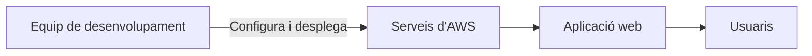
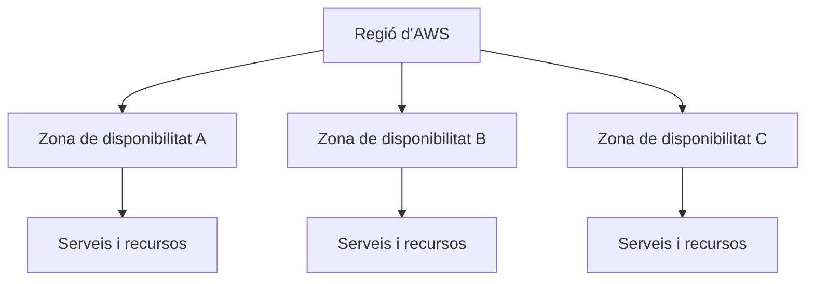

# Bloc 6. AWS: principis bàsics

## Què és AWS?

**Amazon Web Services (AWS)** és una plataforma de serveis al núvol. En lloc de comprar i mantenir tot el maquinari propi, podem llogar recursos informàtics a demanda i gestionar-los des de la consola web, la línia d'ordres o una API.

El núvol no elimina els servidors: els servidors continuen existint, però els gestiona el proveïdor i els utilitzem a través de la xarxa.

### Principis del núvol

- **A demanda:** es poden crear i configurar recursos quan es necessiten, sense comprar abans el maquinari.
- **Elasticitat:** la capacitat es pot ajustar segons la càrrega, manualment o automàticament, si el servei i l'arquitectura ho permeten.
- **Pagament per ús:** el cost depèn dels recursos consumits i de com s'han configurat; tenir un compte no vol dir que tots els serveis siguin gratuïts.

## Serveis: triar l'eina segons la necessitat

AWS ofereix molts serveis. Aquests exemples ajuden a identificar-ne alguns de comuns:

| Necessitat | Servei | Per a què serveix? |
| --- | --- | --- |
| Executar un servidor virtual | **Amazon EC2** | Crear i gestionar màquines virtuals al núvol. |
| Desar fitxers i recursos estàtics | **Amazon S3** | Emmagatzemar objectes, com ara imatges, còpies de seguretat o fitxers d'una web estàtica. |
| Gestionar una base de dades relacional | **Amazon RDS** | Utilitzar bases de dades com PostgreSQL o MySQL sense gestionar directament tot el servidor de base de dades. |
| Executar codi en resposta a esdeveniments | **AWS Lambda** | Executar funcions sense mantenir un servidor permanent. |
| Crear una xarxa privada al núvol | **Amazon VPC** | Definir xarxes, subxarxes i regles de comunicació per als recursos. |

Un servei **gestionat** no vol dir que AWS s'encarregui de tot: el proveïdor administra una part de la infraestructura i el client continua configurant-ne l'ús, l'accés i les dades.

## Infraestructura global: regions i zones

Una **regió** és una àrea geogràfica on AWS agrupa centres de dades. Cada regió conté diverses **zones de disponibilitat** (*Availability Zones* o AZ), que són ubicacions separades amb infraestructura independent.

En triar una regió, cal considerar la proximitat als usuaris, la disponibilitat dels serveis, les necessitats de disponibilitat i les normes sobre on es poden allotjar les dades. Distribuir una aplicació entre diverses zones pot millorar-ne la resiliència, però requereix disseny i pot augmentar-ne el cost.

## Responsabilitat compartida i seguretat

La seguretat al núvol és una **responsabilitat compartida**:

- **AWS** protegeix la infraestructura física i els serveis que ofereix.
- **El client** protegeix el que configura i hi desa: comptes, permisos, dades, aplicacions i configuració de xarxa.

Les responsabilitats concretes depenen del servei. Per exemple, amb una màquina virtual EC2, el client també s'encarrega de mantenir actualitzat el sistema operatiu convidat.

## Cost i consum

Molts serveis es facturen segons els recursos utilitzats, el temps d'execució, l'emmagatzematge o la transferència de dades. El cost depèn del servei, la regió i la configuració.

- Abans de crear recursos, comprova'n el preu i la regió.
- Configura alertes o pressupostos al sistema de facturació.
- Atura o elimina els recursos de pràctiques quan ja no els necessitis.
- No assumeixis que un servei és gratuït: les condicions dels nivells gratuïts poden variar i alguns recursos poden generar càrrecs.

!!! tip "Per practicar"
    Utilitza un compte de laboratori o un entorn de classe quan estigui disponible. No creïs recursos de pagament sense revisar abans el cost i les instruccions de la pràctica.

## Recorregut d'un desplegament senzill

Desplegar una aplicació al núvol vol dir publicar-la en recursos configurats per ser accessibles als seus usuaris. Per exemple, una aplicació que necessita un servidor pot executar-se en EC2.

Abans de desplegar, identifica **què vols publicar**, **qui hi ha d'accedir**, **quines dades utilitza** i **quins recursos costarà mantenir**.

## Idees clau

- AWS ofereix serveis al núvol que es poden combinar segons les necessitats.
- **EC2, S3, RDS, Lambda i VPC** resolen necessitats diferents.
- Les regions i les zones de disponibilitat ajuden a ubicar i dissenyar els recursos.
- AWS i el client comparteixen responsabilitats de seguretat.
- Permisos, credencials i costos s'han de revisar des del principi.

Fonts: [Què és AWS?](https://aws.amazon.com/what-is-aws/), [infraestructura global d'AWS](https://aws.amazon.com/about-aws/global-infrastructure/), [model de responsabilitat compartida](https://aws.amazon.com/compliance/shared-responsibility-model/) i [bones pràctiques de seguretat IAM](https://docs.aws.amazon.com/IAM/latest/UserGuide/best-practices.html).
