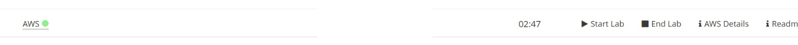
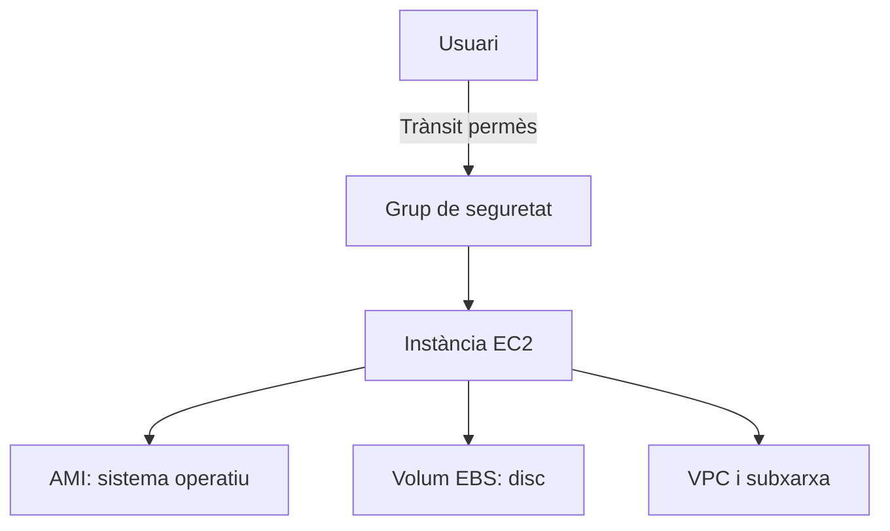
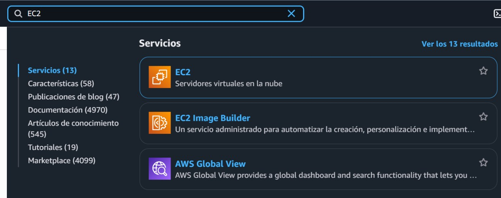
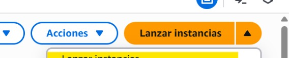
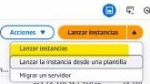

# Bloc 7. Comencem amb AWS Academy

## AWS Academy i el laboratori

**Amazon Web Services (AWS)** és una plataforma de serveis al núvol. En lloc de comprar un servidor físic, podem crear recursos informàtics a Internet i configurar-los segons les necessitats. En aquesta pràctica utilitzarem **Amazon EC2** (*Elastic Compute Cloud*), el servei per crear màquines virtuals.

**AWS Academy** és l'entorn formatiu del curs. Des del laboratori accedim a una consola AWS temporal per fer les pràctiques. L'aspecte i les opcions poden variar una mica segons el curs.

1. Obre el laboratori indicat pel professorat.
2. Prem **Start Lab** i espera que l'estat d'AWS indiqui que està disponible.
3. Prem l'enllaç **AWS** del mateix laboratori per obrir la consola.
4. Quan acabis, desa el que necessitis i prem **End Lab**.



*A la barra del laboratori, inicia'l amb **Start Lab** i tanca'l amb **End Lab** quan acabis. Captura adaptada de la guia de pràctica del curs.*

## Conceptes d'EC2

Una màquina virtual d'EC2 també s'anomena **instància**. En crear-ne una, cal triar-ne els components principals:

| Concepte | Què vol dir? |
| --- | --- |
| **Instància** | El servidor virtual que executa el sistema operatiu i les aplicacions. |
| **AMI** | La imatge de màquina que serveix de base: inclou el sistema operatiu i pot incorporar programari i configuració instal·lats prèviament. |
| **Tipus d'instància** | La combinació de processador, memòria i capacitat de xarxa assignada. Tria-la segons la pràctica i les opcions del laboratori. |
| **Key pair** | Parell de claus que serveix per autenticar-se a la màquina. La clau privada s'ha de mantenir secreta. Si es perd no es pot accedir a la màquina |
| **VPC i subxarxa** | La xarxa virtual i el segment de xarxa on s'ubica la instància. |
| **Grup de seguretat** | Tallafoc virtual que controla el trànsit d'entrada i sortida de la instància. |
| **EBS** | Disc virtual on es desen el sistema i els fitxers. |



## Obrir el servei EC2

Des de la consola AWS, escriu **EC2** al cercador de serveis i selecciona **EC2**. Comprova que ets a la regió indicada pel laboratori; els recursos es creen dins de la regió seleccionada (NO CANVIÏS LA REGIÓ).



*Cercador de la consola AWS: selecciona EC2 per obrir el tauler de les instàncies. Captura adaptada de la guia de pràctica del curs.*

## Crear una instància

Al tauler d'EC2, selecciona **Launch instances** (*Llança instàncies*).



*Inicia la creació d'una instància des del botó **Launch instances**. Captura adaptada de la guia de pràctica del curs.*

A continuació, completa l'assistent seguint les indicacions del laboratori:

1. **Nom:** posa un nom que t'ajudi a identificar la instància.
2. **AMI:** tria el sistema operatiu demanat; per exemple, Ubuntu.
3. **Tipus d'instància:** selecciona un tipus permès pel laboratori. Les opcions i els costos poden variar.
4. **Key pair:** crea o selecciona la clau si la pràctica en necessita. Desa la clau privada en un lloc segur i no la comparteixis ni la pugis a Git.
5. **Xarxa i grup de seguretat:** utilitza la VPC indicada. Obre només els ports que necessitis:
   - **SSH (22):** per administrar Linux. 
   - **HTTP (80):** només si vols servir una web accessible per HTTP.
6. **Emmagatzematge:** comprova la mida del volum EBS i mantén el valor del laboratori si no tens cap requisit diferent.
7. Revisa la configuració i prem **Launch instance**.

Espera que l'estat de la instància sigui **Running** i que les comprovacions d'estat hagin acabat correctament.

### Exemple pràctic: instància Ubuntu amb Docker

En aquest exemple crearem una instància Ubuntu i hi instal·larem Docker Engine. Segueix sempre les restriccions del laboratori: tipus d'instància i AMI disponibles, pressupost i temps de sessió.

1. A **Launch instances**, posa un nom com `ubuntu-docker`.
2. A **Application and OS Images (AMI)**, selecciona una imatge oficial **Ubuntu Server LTS**.
3. Tria el tipus d'instància de menor cost que permeti el laboratori.
4. Crea o selecciona un *key pair* i desa la clau privada al teu ordinador.
5. A la configuració de xarxa, permet **SSH (port 22), HTTP (port 80)** 
6. Revisa i llança la instància. Quan estigui **Running** i les comprovacions siguin correctes, connecta-t'hi amb SSH:

   ```bash
   ssh -i ~/.ssh/clau-privada.pem ubuntu@IP_PUBLICA
   ```

   Canvia el camí de la clau i `IP_PUBLICA` pels valors reals. Si ja has configurat l'àlies SSH més avall, pots connectar-t'hi amb `ssh aws-academy`.

7. Ja dins d'Ubuntu, afegeix el repositori oficial de Docker i [instal·la Docker Engine](https://docs.docker.com/engine/install/ubuntu/) i els complements:

Si vols utilitzar les comandes de docker sense haver de posar sudo cada vegada, afegeix l'usuari al grup de docker.
```bash
sudo usermod -aG docker $USER
```
## Crear una AMI pròpia

Una **AMI** (*Amazon Machine Image*) és la imatge que conté el sistema operatiu i el contingut del disc d'arrencada. Pots crear-ne una a partir d'una instància que ja hagis preparat, per exemple amb Docker i l'aplicació instal·lats. Després podràs utilitzar aquesta AMI per crear altres instàncies amb el mateix programari preinstal·lat.

1. Crea i configura una instància amb el sistema operatiu i el programari que necessitis.
2. Comprova que funciona i desa les dades importants. En crear la imatge, AWS pot reiniciar la instància per obtenir una còpia coherent dels discs.
3. A **EC2 > Instances**, selecciona la instància i tria **Actions > Image and templates > Create image**.
4. Escriu un nom descriptiu per a la imatge i prem **Create image**.
5. A **EC2 > AMIs**, filtra per **Owned by me** i espera que l'estat sigui **Available**. Ja la pots seleccionar en crear una instància.




*El menú **Actions** ofereix operacions sobre una instància seleccionada, com ara llançar-ne una de nova des d'una plantilla. Captura adaptada de la guia de pràctica del curs; el menú pot variar segons la consola.*

## Plantilles de llançament

Una **plantilla de llançament** (*Launch Template*) desa els paràmetres amb què es crea una instància: AMI, tipus d'instància, xarxa, grups de seguretat, disc, *key pair* i, opcionalment, un script de **User Data**. Aquest script s'executa en iniciar una instància i pot automatitzar tasques inicials, com instal·lar Docker.

Per crear-ne una des de la consola, obre **EC2 > Launch Templates > Create launch template**, posa-li un nom i configura els paràmetres que vulguis reutilitzar. Selecciona una AMI (la pròpia o una d'Ubuntu), el tipus i les opcions de xarxa necessàries; desa la plantilla i després utilitza **Launch instance from template** per crear una màquina amb aquests valors.

| AMI | Plantilla de llançament |
| --- | --- |
| És el contingut i la base del disc d'arrencada: sistema operatiu, programari i fitxers preparats. | És la recepta per crear una instància: tria una AMI i desa també altres paràmetres d'EC2. |
| Es crea habitualment a partir d'una instància configurada. | Es crea definint els paràmetres de llançament i pot apuntar a una AMI pròpia. |
| Exemple: Ubuntu amb Docker ja instal·lat. | Exemple: utilitza aquesta AMI d'Ubuntu amb un tipus concret, un grup de seguretat i User Data. |

En resum, **la AMI defineix què hi ha instal·lat a la màquina; la plantilla defineix com es crea la màquina**. Es poden combinar: una plantilla pot reutilitzar una AMI personalitzada. Les plantilles tenen versions; si cal corregir paràmetres, crea una versió nova i llança la instància amb aquesta versió.

!!! tip "Error en llançar una plantilla"
    Si apareix un error relacionat amb algun paràmetre, revisa la configuració i crea una **versió nova** de la plantilla. Després, torna a llançar la instància amb la nova versió.

## Connectar-se i acabar la pràctica

Selecciona la instància i prem **Connect** per veure els mètodes disponibles. Si el laboratori demana SSH des d'un terminal, la forma general és:

```bash
ssh -i clau-privada.pem ubuntu@IP_PUBLICA
```

Substitueix el nom del fitxer i `IP_PUBLICA` pels valors de la pràctica. En altres distribucions, el nom d'usuari pot ser diferent; segueix les instruccions de connexió de l'AMI i del laboratori.

### Configurar `~/.ssh/config` per connectar-se amb un àlies

Per no haver d'escriure la IP, l'usuari i la clau a cada connexió, crea o edita el fitxer `~/.ssh/config` al teu ordinador (amfitrió) i afegeix-hi una entrada com aquesta:

```sshconfig
Host aws-academy
    HostName IP_PUBLICA
    User ubuntu
    IdentityFile ~/.ssh/clau-privada.pem
    IdentitiesOnly yes
    Port 22
```

| Paràmetre | Significat |
| --- | --- |
| `Host aws-academy` | Àlies que tries per identificar aquesta connexió. |
| `HostName IP_PUBLICA` | IP pública o nom DNS de la instància EC2. Substitueix el valor d'exemple pel de la teva instància. |
| `User ubuntu` | Usuari del sistema convidat. Pot variar segons l'AMI. |
| `IdentityFile ~/.ssh/clau-privada.pem` | Ruta de la clau privada corresponent al *key pair* seleccionat en crear la instància. |
| `IdentitiesOnly yes` | Indica a SSH que utilitzi la clau especificada, en lloc de provar altres claus carregades. |
| `Port 22` | Port del servei SSH; és el port per defecte. |

Desa el fitxer i protegeix la clau privada perquè només el teu usuari la pugui llegir:

```bash
chmod 600 ~/.ssh/clau-privada.pem
```

A partir d'ara, connecta't amb l'àlies:

```bash
ssh aws-academy
```

L'àlies només estalvia haver d'escriure les opcions; **no elimina l'autenticació amb la clau privada**. Si la instància rep una IP pública nova, actualitza `HostName`. No comparteixis ni pugis el fitxer de clau privada a Git.

Quan acabis:

1. Tanca la sessió SSH amb `exit`, si t'hi has connectat.
2. Atura o elimina la instància només tal com indiqui l'activitat.
3. Prem **End Lab** per tancar el laboratori.

Aturar una instància i finalitzar el laboratori no sempre elimina tots els recursos. En un compte propi, alguns recursos —com els volums EBS— poden continuar generant costos. Revisa sempre les instruccions i els recursos actius.

## Idees clau

- AWS ofereix serveis al núvol; EC2 serveix per crear servidors virtuals.
- Una instància es configura amb una AMI, un tipus, una xarxa, un grup de seguretat i emmagatzematge.
- Les claus privades són secretes i les regles de xarxa han de permetre només el trànsit necessari.
- Utilitza l'entorn del laboratori i tanca'l en acabar.

Les captures de pantalla s'han adaptat de la [guia de pràctica AWS: primera màquina](<pdfs/AWS-1-PRIMERA MÀQUINA.pdf>). Per a informació actualitzada, consulta la documentació oficial d'[Amazon EC2](https://docs.aws.amazon.com/ec2/) i les instruccions del teu laboratori.

Instal·lació de Docker basada en la [guia oficial de Docker Engine per a Ubuntu](https://docs.docker.com/engine/install/ubuntu/). Per crear una [AMI a partir d'una instància](https://docs.aws.amazon.com/AWSEC2/latest/UserGuide/creating-an-ami-ebs.html) i [crear una plantilla de llançament](https://docs.aws.amazon.com/AWSEC2/latest/UserGuide/create-launch-template.html), consulta la documentació oficial d'AWS.
