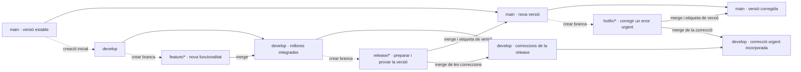

# Bloc 7. Git Flow i col·laboració entre equips

**Pregunta clau:** com organitzem el treball quan hi ha més d'un equip i la feina es comparteix?

Git Flow és un model de treball que organitza el repositori en branques segons la funció de cada canvi. La idea és separar la versió estable del projecte de les millores i correccions que desenvolupadors fan al mateix temps.

## 1. Les branques principals

Les branques més habituals són:

- `main` o `master`: la línia estable del projecte, la que es publica i serveix per a producció.
- `develop`: la línia de desenvolupament on s'integren les millores abans de publicar.
- `feature/*`: branques de funcionalitat per treballar noves millores aïllades.
- `release/*`: branques per preparar una nova versió abans de publicar-la.
- `hotfix/*`: branques per corregir errors urgents en producció.

Un esquema simplificat seria:



**Com es llegeix:** d'esquerra a dreta. Les fletxes discontínues indiquen on es crea una branca (**divergència**); les fletxes amb `merge` indiquen on s'integren els seus canvis (**convergència**). Les fletxes entre nodes de `main` o de `develop` representen la continuïtat d'aquestes branques. És un esquema del flux, no un historial de commits concret.

| Tipus de branca | Neix de… | S'integra a… | Finalitat |
| --- | --- | --- | --- |
| `main` | Inici del repositori. | Es manté com a línia estable. | Conservar les versions publicables, identificades amb etiquetes com `v1.0.0`. |
| `develop` | `main`, en configurar el flux inicial. | Les seves versions es publiquen a `main` a través de `release/*`. | Integrar el treball de la propera versió. |
| `feature/*` | `develop`. | `develop`. | Desenvolupar una funcionalitat; se'n poden tenir diverses en paral·lel. |
| `release/*` | `develop`. | `main` i `develop`. | Estabilitzar una versió i retornar les correccions al desenvolupament. |
| `hotfix/*` | `main`. | `main` i `develop`. | Corregir producció i evitar que l'error reaparegui en la propera versió. |

**Exemple:** `feature/login` surt de `develop` i hi torna quan està revisada. Després, `release/1.0.0` surt de `develop` i s'integra a `main` per publicar; les seves correccions també tornen a `develop`. Si es detecta un error urgent, `hotfix/1.0.1` surt de `main` i la correcció s'incorpora tant a `main` com a `develop`.

Si hi ha una `release/*` oberta quan es resol un `hotfix/*`, la correcció també s'ha d'incorporar a aquesta release; arribarà a `develop` en integrar-la. `main` i `develop` són permanents; les branques de funcionalitat, release i hotfix es poden eliminar després d'integrar els canvis als destins corresponents.

L'objectiu és que la branca principal no quedi “bruta” amb funcionalitats incompletes, i que cada millora es revisi abans d'integrar-se.

## 2. Flux típic de Git Flow

1. Es parteix de `develop` o de `main` segons el model del projecte. (Habitualment, `develop` és la branca on es treballa abans de publicar a `main`.)
2. Es crea una branca `feature/*` per a cada millora.
3. Es treballa en aquesta branca amb commits petits i coherents.
4. Es publica la branca i es revisa la `pull request` o `merge request`.
5. Es fusiona a `develop` o a `main` segons la situació. (Habitualment, primer a `develop` i després a `main` quan es publica.)
6. Si cal preparar una versió pública, es crea una branca `release/*`.
7. Si apareix un error urgent, es crea un `hotfix/*` i es soluciona ràpidament.

Git Flow és útil en projectes amb més equips, versions formals i processos de revisió més estructurats. No sempre és necessari seguir-lo al peu de la lletra; en projectes petits o àgils sovint es fa servir un model més simple, com GitHub Flow.

## 3. Col·laboració entre equips

En un projecte real, diferents desenvolupadors poden treballar sobre el mateix repositori al mateix temps. Cada un parteix d'una base comuna i crea la seva branca de feina.

```text
Base comuna
A --- B --- C --- D --- E --- F
     \             \            \
      \- Equip A:   \- Equip B:   \- Equip C:
          D1 --- D2        G1 --- G2      H1 --- H2
```

El procés habitual és:

1. Tots els desenvolupadors parteixen de la mateixa versió recent de `main` o `develop`.
2. Cada un crea la seva branca, per exemple `feature/login` o `feature/payments`.
3. Desenvolupen, fan commits coherents i revisen el codi.
4. Obren una pull request o merge request per demanar la integració.
5. Un altre company revisa els canvis i pot demanar ajustaments.
6. Quan la revisió és correcta, la branca s'integra a la branca principal.
7. Els altres desenvolupadors actualitzen la seva feina per evitar treballar sobre una base antiga.

La línia de temps és molt important: si un desenvolupador es queda endarrerit respecte a `main`, pot haver de sincronitzar la seva branca abans d'integrar els canvis. Si no ho fa, pot generar conflictes o incorporar funcionalitats obsoletes.

## 4. La línia de temps i el rebase

El `rebase` és útil perquè permet “reaplicar” els teus commits sobre una nova base i deixar l'historial més lineal. Però també té un efecte important: reescriu la línia de temps.

### Sense rebase

```text
A --- B --- C   main
     \ 
      D --- E   branca de treball
```

Aquí la branca conserva la seva història i la integració es fa amb un merge.

### Amb rebase

```text
A --- B --- C --- D' --- E'
```

Git reescriu els commits `D` i `E` perquè queden sobre la nova base. Això fa que el seu identificador canviï i, per tant, la història no és la mateixa que abans.

### Per què s'aconsella tenir precaució quan col·labores?

Perquè el rebase reescriu la història compartida. Si altres companys ja han treballat sobre els teus commits o els han basat en ells, canviar-los pot provocar:

- commits duplicats o apareguts amb dos identificadors diferents,
- divergències de l'historial entre desenvolupadors,
- confusions a l'hora de seguir qui va fer què,
- conflictes en sincronitzar branques compartides.

Per això, el rebase és recomanable sobretot en branques privades o encara no publicades. Si els commits ja han anat al remot i altres persones els poden haver utilitzat, es recomana fer-ho amb molta precaució i coordinar-ho amb l'equip.

> Regla pràctica: no reescriguis la història d'una branca compartida sense avisar i sense saber que altres persones també hi treballen.

## 5. Resolució de conflictes

Un conflicte apareix quan Git no pot decidir automàticament quina versió del codi ha de quedar final perquè dues branques han modificat la mateixa zona de manera incompatible.

```text
<<<<<<< HEAD
codi de l'Equip A
=======
codi de l'Equip B
>>>>>>> feature/altres-canvis
```

El procés correcte és:

1. Executa `git status` per veure els fitxers en conflicte.
2. Obre cada fitxer conflictiu i revisa els blocs marcats amb `<<<<<<<`, `=======` i `>>>>>>>`.
3. Decideix quina versió és correcte o combina les dues parts de manera coherent.
4. Elimina els marcadors i desa el resultat final.
5. Executa `git add FITXER_RESOLT`.
6. Finalitza la integració amb `git commit`.

Si la integració encara no està preparada, pots cancel·lar-la amb `git merge --abort` o `git rebase --abort`, segons el cas. La clau és mantenir el codi coherent i provar-lo abans de continuar.

## 6. Regles útils per a treball en equip

- Fes commits petits i amb missatges clars.
- Actualitza la branca abans de començar una millora important.
- Revisa i comunica els canvis abans d'integrar-los a la branca principal.
- No rebasegis la història compartida sense coordinar-ho amb el grup.
- Resoldre conflictes és part del treball col·laboratiu, no un error del sistema.

En resum, Git no només guarda versions: també ens permet coordinar molts equips, gestionar la línia de temps i decidir com integrar el treball respectant la història del projecte.

**Pràctica:** explica què passa si dues persones modifiquen la mateixa línia de codi en dues branques diferents, i què has de fer per resoldre el conflicte sense perdre la feina de cap de les dues parts.
