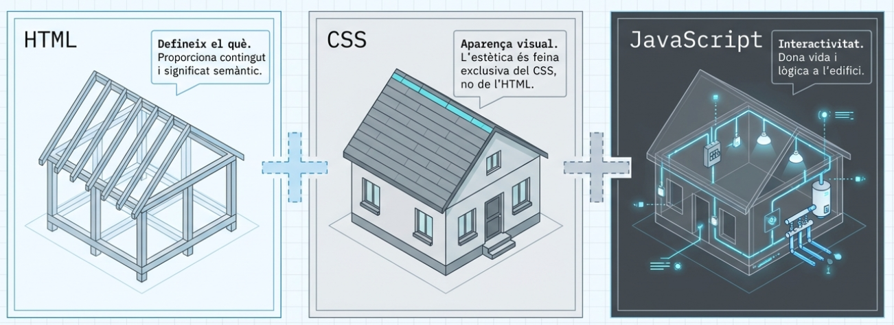
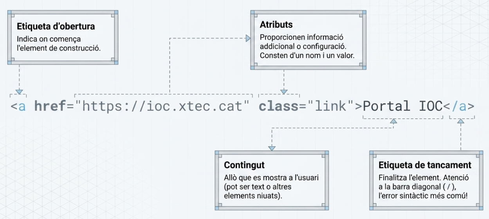
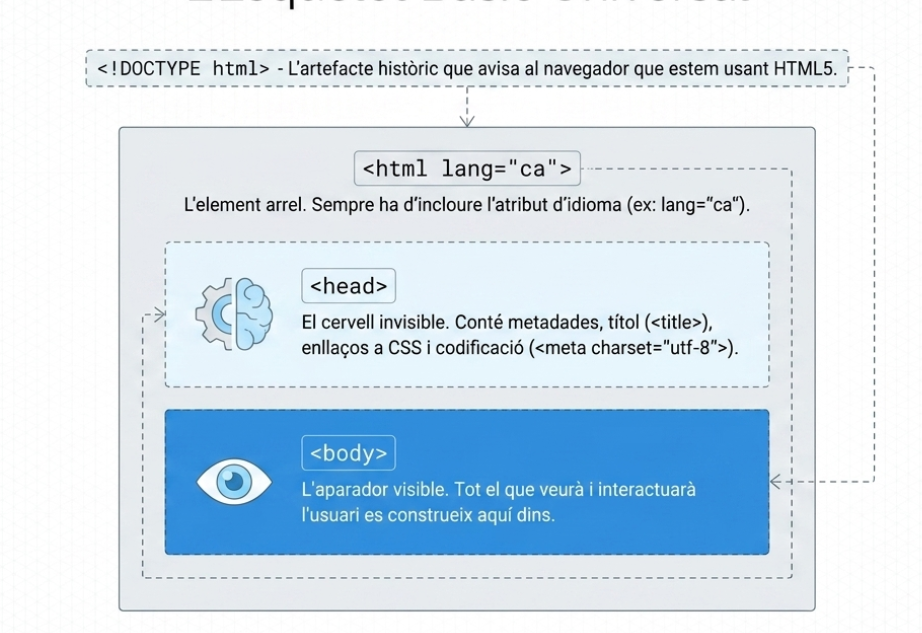
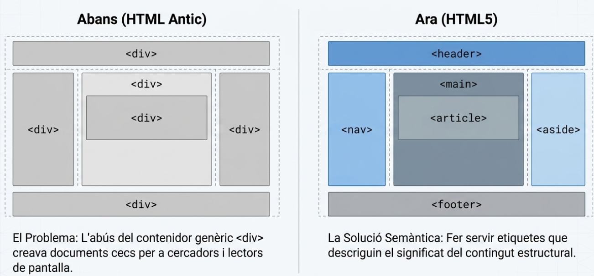

# Bloc 1: Fonaments de l'HTML5

## 1. Què és l'HTML5?

L'HTML (**HyperText Markup Language**) és la tecnologia que defineix el contingut i l'estructura de qualsevol lloc web.

* **Semàntica:** L'HTML5 introdueix etiquetes que descriuen el significat del contingut de manera que les màquines el puguin entendre, cosa vital per a l'accessibilitat i el SEO.
* **Objectiu:** Millorar la interoperabilitat i oferir funcionalitats estàndard per a multimèdia i aplicacions web.


---

## 2. Anatomia d'un Element HTML

La sintaxi es basa en elements que inclouen [6, 7]:

* **Etiqueta d'obertura:** `<nom_etiqueta>`.
* **Atributs:** Proporcionen propietats extra (ex: `class`, `id`, `lang`, `href`) .
* **Contingut:** El text o elements niats.
* **Etiqueta de tancament:** `</nom_etiqueta>`.
* **Elements buits (void):** No tenen contingut ni tancament (ex: ``, `<br>`)



---

## 3. Estructura Bàsica del Document

Tot document ha de seguir aquesta jerarquia essencial :

1. **`<!DOCTYPE html>`:** Obligatori per indicar que s'usa l'estàndard HTML5 .
2. **`<html lang="ca">`:** L'element arrel on cal especificar l'idioma per als lectors de pantalla .
3. **`<head>`:** Contenidor de metadades (títol, codificació `charset`, enllaços a CSS) no visibles.
4. **`<body>`:** Conté tot el contingut que l'usuari veurà.



---

## 4. Elements de Bloc i Elements Inline

En HTML, els elements es comporten principalment de dues maneres: com a **bloc** o com a **inline**.

### Elements de bloc

Un element de bloc ocupa, per defecte, tota l'amplada disponible i comença en una línia nova.

* Exemples habituals: `<div>`, `<p>`, `<h1>`...`<h6>`, `<section>`, `<article>`, `<ul>`, `<li>`.
* S'utilitzen per estructurar grans parts del contingut.

### Elements inline

Un element inline només ocupa l'espai del seu contingut i no força un salt de línia.

* Exemples habituals: `<span>`, `<a>`, `<strong>`, `<em>`, ``, `<code>`.
* S'utilitzen per donar significat o estil a parts concretes dins d'un text.

### Exemple ràpid

```html
<p>
   Aquest text conté un <strong>element inline</strong> i un
   <a href="#">enllac inline</a>.
</p>

<div>
   Aquest bloc comenca en una nova linia i ocupa tota l'amplada disponible.
</div>
```

---

## 5. Estructura Semàntica Principal

L'HTML5 defineix elements per descriure les zones de la pàgina [14-16]:

* **`<header>`:** Capçalera amb logos o títols de la secció [16, 17].
* **`<nav>`:** Bloc de navegació principal [5, 16, 17].
* **`<main>`:** Contingut principal i únic de la pàgina [16, 18].
* **`<section>`:** Agrupa contingut relacionat temàticament [16, 19].
* **`<article>`:** Contingut autònom i independent (notícies, posts) [16, 18, 20].
* **`<aside>`:** Contingut relacionat de manera indirecta (barres laterals) [16, 18].
* **`<footer>`:** Peu de pàgina amb info legal o xarxes socials [5, 16, 18].



!!! success "Adeu divitis"

    L'ús excessiu de `<div>` sense semàntica és desaconsellat. Els nous elements semàntics milloren l'accessibilitat, el SEO i la comprensió del contingut
---

## 6. Els Encapçalaments (`<h1>` - `<h6>`)

S'usen per crear una jerarquia lògica de contingut :

* **`<h1>`:** Ha de ser únic i representar el tema principal.
* **No saltis nivells:** L'estructura ha de ser seqüencial per no desorientar els usuaris de lectors de pantalla.

---

## 7. Accessibilitat Web (Principis WCAG)

L'accessibilitat garanteix que tothom pugui percebre, operar i entendre el web, independentment de les seves capacitats :

1. **Perceptible:** Info presentada de manera que es pugui detectar pels sentits.
2. **Operable:** La interfície ha de ser navegable, especialment amb teclat.
3. **Comprensible:** El funcionament i la info han de ser clars.
4. **Robust:** Compatible amb diferents navegadors i ajudes tècniques.

---

## 8. Bones Pràctiques i Validació

* **Text alternatiu (`alt`):** Totes les imatges l'han de tenir per descriure el contingut.
* **Etiquetes de formulari (`<label>`):** Associa sempre el text amb el seu `<input>` mitjançant els atributs `for` i `id`.
* **Validació W3C:** Utilitza el validador oficial per corregir errors de sintaxi o anidament.

## 9. Referències i Recursos de Consulta

1. **Semantic HTML - MDN Web Docs**
   * [HTML: HyperText Markup Language - Curriculum](https://developer.mozilla.org/en-US/curriculum/core/semantic-html/)
   * *Descripció:* Defineix la tecnologia HTML i la importància de la semàntica per a l'accessibilitat i el SEO.

2. **Estructura - Accesible.es**
   * [Guía rápida de accesibilidad web: Estructura](https://accesible.es/estructura)
   * *Descripció:* Marcado semàntic de seccions (header, nav, main, article) per a l'accessibilitat .

3. **Etiquetes i atributs - XTEC (Aplicacions Web)**
   * [Materials IOC: Fonaments d'HTML](https://ioc.xtec.cat/materials/FP/Recursos/fp_smx_m08_/web/fp_smx_m08_htmlindex/WebContent/u2/a2/continguts.html)
   * *Descripció:* Sintaxi d'etiquetes, atributs globals i classificació d'elements de bloc i de línia.

4. **HTML 5 - Viquipèdia**
    * [HTML 5 - L'enciclopèdia lliure](https://ca.wikipedia.org/wiki/HTML_5)
    * *Descripció:* Història, nous elements semàntics (nav, footer, audio, video) i novetats de l'estàndard 


5. **Patrons de disseny web adaptatiu - IOC**
    * [Materials IOC: Patrons i Frameworks web (PDF)](https://ioc.xtec.cat/materials/FP/Recursos/fp_smx_m08_/web/fp_smx_m08_htmlindex/index.html)
    * *Descripció:* Estratègies de disseny (Mobile First) i implementació de graelles flexibles 

6. **Principis d'accessibilitat web (WCAG) - IOC**
    * [Materials IOC: Les WCAG 2.1](https://ioc.xtec.cat/materials/FP/Recursos/fp_daw_m09_/web/fp_daw_m09_htmlindex/WebContent/u5/a3/continguts.html)
    * *Descripció:* Els quatre principis (Perceptible, Operable, Entenedor, Robust) i tècniques d'accessibilitat 

7. **Flexbox Froggy - Joc educatiu**
    * [Aprendre Flexbox jugant](https://flexboxfroggy.com/#ca)
    * *Descripció:* Eina interactiva per practicar les propietats d'alineació de Flexbox 

8. **Validator W3C: Guía de validación - Leandro Fuentes**
    * [Cómo validar tu HTML como un pro](https://leandrofuentes.com/blog/validator-w3c-guia/)
    * *Descripció:* Ús del validador oficial del W3C i del Nu HTML Checker per assegurar codi sense errors .
