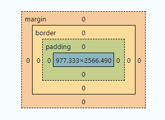

# Bloc 2: CSS - espai i caixa

Aquest bloc assenta la base de CSS abans d'entrar en frameworks. L'objectiu és dominar com CSS calcula espais, com resol conflictes d'estils i quines unitats convé usar.

---

## 1. Objectiu del bloc

En acabar aquest bloc, l'alumnat ha de poder:

1. Entendre com funciona el **Box Model**.
2. Predir quina regla guanya en la **cascada**.
3. Comparar i aplicar **especificitat** amb criteri.
4. Triar **unitats** adequades per espaiat i mida.

Idea clau: si controles espai i caixa, controles gran part dels problemes reals de maquetació.

---

## 2. Box Model: com ocupa espai una caixa

Tot element es representa com una caixa formada per:

* **Content**: contingut real (text, imatge, icona).
* **Padding**: espai intern entre contingut i vora.
* **Border**: vora de la caixa.
* **Margin**: espai extern entre caixes.

### Exemple base

Veure demo: [Box Model](demos/2_exemples_css_espai_caixa.html#boxmodel)

Amb el model per defecte (`content-box`), l'amplada visible no és 320px exactes: s'hi afegeixen `padding` i `border`.

---

## 3. `box-sizing`: control real de dimensions

Per evitar càlculs manuals, es recomana usar:

Veure demo: [Box sizing en acció](demos/2_exemples_css_espai_caixa.html#boxmodel)

Amb `border-box`, l'amplada declarada ja inclou `padding` i `border`.

### Comparació ràpida

* `content-box`: amplada final = `width + padding + border`
* `border-box`: amplada final = `width`

Veure demostració: [Box Model amb i sense border-box](demos/2_boxmodel.html)

---

## 4. Cascada: quina regla CSS s'aplica

Quan dues regles afecten la mateixa propietat del mateix element, CSS resol en aquest ordre:

1. Importància (`!important`).
2. Especificitat del selector.
3. Ordre d'aparició (la darrera guanya si empaten).

Veure demo: [Cascada](demos/2_exemples_css_espai_caixa.html#cascada)

No depengues de `!important` com a solució habitual. Millor estructurar bé selectors i components.

---

## 5. Especificitat: qui té més pes

La regla amb més pes guanya. Resum pràctic:

* Etiqueta (`p`, `h2`) -> pes baix.
* Classe (`.card`, `.menu-item`) -> pes mitjà.
* ID (`#hero`) -> pes alt.

Veure demo: [Especificitat](demos/2_exemples_css_espai_caixa.html#especificitat)

### Bon criteri per a primer projecte

* Prioritza classes.
* Evita selectors massa llargs.
* Evita `!important` excepte casos puntuals molt justificats.

---

## 6. Unitats CSS: triar bé les mides

### Unitats principals

* **`px`**: valor fix; útil en detalls com vores fines.
* **`rem`**: relatiu a la mida base del document; ideal per espai i tipografia.
* **`%`**: relatiu al contenidor pare.
* **`vw`/`vh`**: relatiu a la finestra del navegador.

### Recomanació didàctica

Per a un primer projecte modern:

* Usa `rem` en `padding`, `margin`, `gap` i tipografia.
* Usa `%` per amplades fluides.
* Reserva `px` per casos concrets.

Veure demo: [Unitats CSS](demos/2_exemples_css_espai_caixa.html#unitats)

---

## 7. Espaiat coherent: ritme visual del projecte

Sense sistema d'espai, la interfície sembla irregular. Una pauta simple:

* Base: `0.5rem`
* Escala habitual: `0.5rem`, `1rem`, `1.5rem`, `2rem`, `3rem`

Aplicació pràctica:

* `padding` intern de targetes: `1rem` o `1.5rem`
* espai entre blocs (`margin-block`): `2rem`
* separació entre elements en fila (`gap`): `1rem`

---

## 8. Errors habituals en espai i caixa

* Barrejar moltes unitats sense criteri.
* No aplicar `box-sizing: border-box` al començament.
* Fer servir IDs per tot i després no poder sobreescriure estils fàcilment.
* Corregir conflictes amb `!important` en lloc de revisar cascada/especificitat.
* Espais aleatoris que trenquen la consistència visual.

---

## 9. Checklist de revisió

Abans de donar per bo el CSS:

* Cada component té clar `padding`, `border` i `margin`.
* Saps explicar per què guanya una regla i no una altra.
* Predominen classes per damunt d'IDs.
* Les mides principals estan en `rem` i les amplades en `%`/`rem`.
* El ritme d'espais és coherent a tota la pàgina.

---

## Recursos oficials de consulta

* **MDN - Introduction to the CSS box model**
	* https://developer.mozilla.org/en-US/docs/Web/CSS/CSS_box_model/Introduction_to_the_CSS_box_model
* **MDN - box-sizing**
	* https://developer.mozilla.org/en-US/docs/Web/CSS/box-sizing
* **MDN - Cascade**
	* https://developer.mozilla.org/en-US/docs/Web/CSS/Cascade
* **MDN - Specificity**
	* https://developer.mozilla.org/en-US/docs/Web/CSS/Specificity
* **MDN - Values and units**
	* https://developer.mozilla.org/en-US/docs/Learn/CSS/Building_blocks/Values_and_units
* **W3C - CSS Cascading and Inheritance Level 5**
	* https://www.w3.org/TR/css-cascade-5/

---

## 10. El 20% que han de recordar sempre

1. **Box Model**: tota caixa té content, padding, border i margin.
2. **`box-sizing: border-box`** evita molts errors de dimensions.
3. **Cascada**: importància, especificitat i ordre decideixen el resultat.
4. **Especificitat**: classes millor que IDs per mantenibilitat.
5. **Unitats**: `rem` per espais i text, `%` per amplades fluides.
6. **Consistència**: un sistema d'espaiat simple val més que valors improvisats.

---

## Resum del bloc

Aquest bloc no tracta de decoració, sinó de control tècnic del CSS. Quan l'alumnat domina **Box Model, cascada, especificitat i unitats**, pot construir interfícies sòlides, previsibles i fàcils de mantenir; exactament la base que cal abans de Bootstrap o Tailwind.
