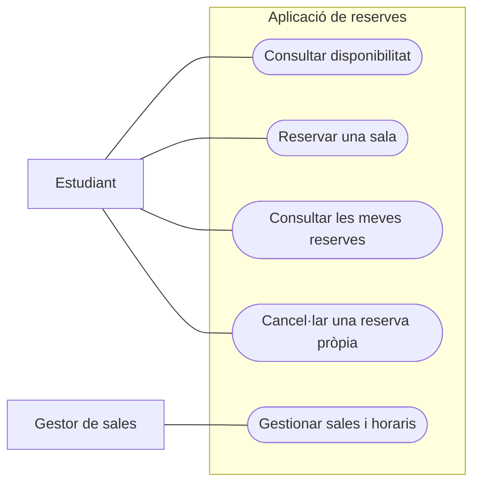

# Bloc 3. Diagrames i escenaris de casos d'ús

Un cas d'ús descriu un objectiu que un actor vol aconseguir interactuant amb el sistema. El diagrama ajuda a representar visualment els actors, els objectius i el límit del sistema.

## Actor i cas d'ús

- **Actor:** un rol extern que interactua amb el sistema. Pot ser una persona o un altre sistema. «Estudiant» és un rol; no és una persona concreta.
- **Cas d'ús:** un objectiu o servei que el sistema ofereix a un actor, com «Consultar disponibilitat».
- **Límit del sistema:** indica què forma part de l'aplicació i què en queda fora.

Un actor no és necessàriament una persona: un servei d'identitat extern també pot ser actor si intercanvia informació amb l'aplicació.

## Exemple: reservar una sala

El diagrama ofereix una vista general. No explica encara tots els passos, les dades ni les excepcions. Per a això escrivim escenaris o descripcions de casos d'ús.

## Escenari textual: reservar una sala

**Actor principal:** estudiant  
**Objectiu:** obtenir una reserva confirmada per a una sala disponible.  
**Precondició:** l'estudiant ha iniciat sessió.  
**Resultat esperat:** la reserva queda desada i es mostra la confirmació.

**Escenari principal:**

1. L'estudiant tria una data i una franja horària.
2. El sistema mostra les sales disponibles.
3. L'estudiant selecciona una sala.
4. El sistema comprova que continua lliure.
5. El sistema desa la reserva i mostra la confirmació.

**Alternativa:** si una altra persona ha reservat la sala abans de confirmar, el sistema no crea la reserva i demana que se'n triï una altra.

## Relació entre casos d'ús i històries

Un cas d'ús descriu un objectiu i pot contenir diversos escenaris. Una història d'usuari és una peça de backlog centrada en valor, que l'equip pot refinar i prioritzar.

| Cas d'ús | Història relacionada | Exemple d'escenari |
|---|---|---|
| Consultar disponibilitat | Com a estudiant, vull veure les sales lliures en una franja per escollir-ne una. | Hi ha dues sales disponibles i es mostren totes dues. |
| Reservar una sala | Com a estudiant, vull reservar una sala lliure per assegurar-me que la tindré. | La sala continua lliure i la reserva es confirma. |
| Reservar una sala | La mateixa història de reserva. | Una altra persona acaba de reservar-la i el sistema informa del conflicte. |
| Cancel·lar una reserva pròpia | Com a estudiant, vull cancel·lar una reserva meva per alliberar la sala. | La reserva es cancel·la i la franja torna a estar lliure. |

La relació és sovint de molts a molts: un cas d'ús pot correspondre a diverses històries i una història pot cobrir una part d'un cas d'ús. No cal forçar una equivalència un a un.

## Quan és útil un diagrama?

Fes-lo servir quan ajudi a respondre preguntes concretes: quins rols intervenen?, què és dins del sistema?, quins objectius falten? Si el producte és petit i el diagrama no aporta comprensió, una llista clara pot ser suficient.

El diagrama no substitueix les converses amb el client, les històries, els criteris d'acceptació ni la implementació. És una vista de suport per compartir i revisar l'abast funcional.
