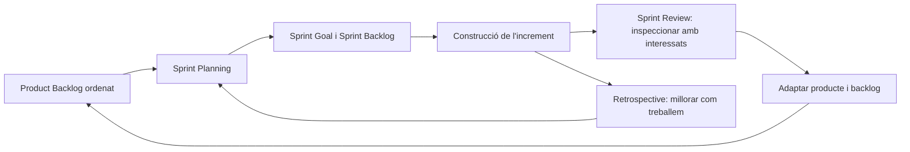

# Bloc 5. Treballar amb Scrum

Scrum és un marc de treball lleuger "Agile" per ajudar un equip a generar valor davant de problemes complexos. Organitza el treball en iteracions curtes, fa visible el progrés i crea moments per inspeccionar el resultat i adaptar el pla.

Scrum no és només fer reunions diàries, ni és una seqüència detallada de passos de desenvolupament. Les històries d'usuari, els diagrames de casos i les tècniques de tasques són pràctiques que es poden fer servir dins d'un equip Scrum, però no són artefactes obligatoris definits pel marc.

## L'equip Scrum

L'equip Scrum és una unitat sense subequips ni jerarquies internes i inclou tres responsabilitats:

- **Product Owner:** maximitza el valor del producte i gestiona eficaçment el Product Backlog: comunica l'objectiu, crea o fa entendre els elements i els ordena.
- **Scrum Master:** ajuda a establir Scrum i a millorar l'eficàcia de l'equip; dona suport perquè l'equip i l'organització entenguin el marc.
- **Developers:** creen l'increment utilitzable. Organitzen la feina, planifiquen el Sprint Backlog, mantenen la qualitat i adapten el pla.

«Developers» és el nom de la responsabilitat en la guia de Scrum, no vol dir només programadors: inclou les persones que fan la feina necessària per crear l'increment.

## Sprint i esdeveniments

Un **Sprint** és un període de durada fixa d'un mes o menys. Conté la planificació, el Daily Scrum, la revisió i la retrospectiva. Cada Sprint ha de produir un increment que aporta valor i compleix la Definition of Done.

| Esdeveniment | Per a què serveix | Exemple amb les reserves |
|---|---|---|
| Sprint Planning | L'equip defineix per què el Sprint és valuós, què pot completar i com començarà la feina. | Objectiu: que l'alumnat pugui consultar i reservar una sala. |
| Daily Scrum | Els Developers inspeccionen el progrés cap a l'objectiu del Sprint i adapten el pla. | Detecten que la regla de solapament encara no està acordada i la fan visible. |
| Sprint Review | L'equip i les persones interessades inspeccionen el resultat i decideixen adaptacions futures. | El client prova una reserva i demana aclarir què passa en cas de conflicte. |
| Sprint Retrospective | L'equip identifica maneres de millorar la qualitat i l'eficàcia del seu treball. | Decideixen validar abans les regles de negoci amb el client. |

El Daily Scrum no és una reunió d'estat per informar un responsable. És una oportunitat dels Developers per revisar el progrés i ajustar el pla.

## Artefactes i compromisos

| Artefacte | Què fa visible | Compromís associat |
|---|---|---|
| Product Backlog | La feina coneguda que pot millorar el producte, ordenada i evolutiva. | Product Goal |
| Sprint Backlog | L'objectiu del Sprint, els elements seleccionats i el pla de treball dels Developers. | Sprint Goal |
| Increment | El resultat utilitzable que compleix la Definition of Done, integrat amb els increments anteriors. | Definition of Done |

El Sprint Goal dona coherència a les històries escollides: explica quin resultat es vol aconseguir, no només quantes tasques volem tancar. Una tasca marcada com a «feta» no implica necessàriament que hi hagi un increment utilitzable.

## On encaixen les històries i els casos d'ús?

1. Les converses amb el client i els usuaris revelen necessitats i regles.
2. Les històries expressen resultats valuosos des del punt de vista d'un usuari; poden ser elements del Product Backlog.
3. Els casos d'ús i els seus escenaris ajuden a entendre actors, límits i comportaments possibles.
4. Els criteris d'acceptació concreten exemples de comportament per a una història.
5. Durant el refinament i la planificació, l'equip aclareix les històries i descompon la feina en un pla de tasques.
6. A la Sprint Review s'inspecciona l'increment amb les persones interessades; el que s'aprèn pot canviar el Product Backlog.

Scrum no obliga a escriure històries d'usuari ni a fer diagrames UML. Són eines que triem si milloren la comprensió i la conversa. Tampoc hi ha un esdeveniment Scrum formal anomenat «refinament»: el refinament és una activitat continuada per afegir detall, ordre i mida als elements del Product Backlog.

## El cicle d'inspecció i adaptació

L'objectiu no és seguir el pla original encara que les evidències el contradiguin. L'objectiu és fer visible què hem après i adaptar el producte i la manera de treballar.

Consulta la [Scrum Guide oficial](https://scrumguides.org/scrum-guide.html) per a la definició completa del marc.
