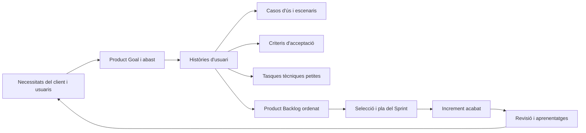

# M616 - Projecte

Aquest mòdul tracta com transformar una necessitat d'un client en un producte que un equip pugui construir, revisar i millorar. La planificació no comença repartint tasques de programació: primer cal entendre quin problema es vol resoldre i per a qui.

Treballarem amb un únic exemple al llarg dels blocs: una aplicació per consultar i reservar sales d'estudi. És un cas fictici que ens permet connectar les tècniques; en un projecte real, les decisions s'han de validar amb el client i les persones usuàries.

## Objectius del mòdul

En acabar, l'alumnat hauria de poder:

- recollir i ordenar necessitats del client i les persones usuàries;
- descriure funcionalitats amb històries d'usuari;
- representar els límits del sistema i les interaccions amb un diagrama de casos d'ús;
- dividir una funcionalitat en tasques petites i comprovables;
- redactar criteris d'acceptació observables;
- organitzar el treball amb els rols, esdeveniments i artefactes de Scrum;
- explicar la traçabilitat entre necessitat, història, cas d'ús, tasques i increment.

## El fil conductor: de la necessitat al producte

El diagrama no és una cadena rígida de documents. És una manera de mostrar com connectem les decisions: descobrim necessitats, descrivim valor, aclarim el comportament, planifiquem feina i comprovem el resultat amb les persones interessades.

## Blocs

- [Bloc 1. Entendre el client i definir el problema](1_Entendre_client.md)
- [Bloc 2. Històries d'usuari i Product Backlog](2_Histories_usuari.md)
- [Bloc 3. Diagrames i escenaris de casos d'ús](3_Casos_dus.md)
- [Bloc 4. Tasques petites i criteris d'acceptació](4_Tasques_i_criteris.md)
- [Bloc 5. Treballar amb Scrum](5_Scrum.md)
- [Bloc 6. Cas pràctic: de la petició al Sprint](6_Cas_practic.md)

## Una distinció important

Les tècniques d'anàlisi i planificació ajuden a entendre i organitzar el treball. Scrum és un marc de treball per gestionar feina complexa de manera iterativa i adaptativa. Es poden fer servir junts, però un diagrama o una història d'usuari no són, per si sols, Scrum.

La guia de referència de Scrum és [The Scrum Guide](https://scrumguides.org/scrum-guide.html). En aquest mòdul en presentem els elements bàsics sense convertir-los en una recepta universal: l'equip ha d'inspeccionar els resultats i adaptar la manera de treballar.
