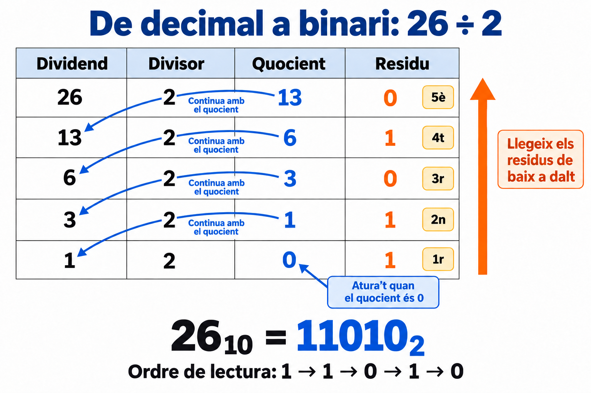

# Bloc 2. Sistemes de numeració i conversions

**Pregunta clau:** com podem escriure una mateixa quantitat en decimal, binari, octal i hexadecimal?

Al bloc anterior hem vist que els ordinadors representen les dades amb bits. Ara aprendrem a interpretar nombres binaris i a convertir-los a altres sistemes de numeració.

Treballarem amb **nombres enters no negatius**: 0, 1, 2, 3… Les fraccions i la representació de nombres negatius es treballaran més endavant.

!!! note "Com es diu cada sistema?"
    **Octal** és el nom del sistema de base 8. **Hexadecimal** és el de base 16. En aquest context, el terme correcte és octal, no «octadecimal».

## 1. Què aprendràs?

- Entendre què és la base d'un sistema de numeració.
- Convertir de decimal a binari i de binari a decimal.
- Convertir de decimal a octal i hexadecimal, i fer el camí invers.
- Passar de binari a octal o hexadecimal agrupant bits.
- Comprovar els resultats fent la conversió inversa.

## 2. Una mateixa quantitat, diferents maneres d'escriure-la

La **base** indica quants dígits diferents utilitza un sistema de numeració.

| Sistema | Base | Dígits que podem utilitzar |
| --- | --- | --- |
| Decimal | 10 | `0`, `1`, `2`, `3`, `4`, `5`, `6`, `7`, `8`, `9` |
| Binari | 2 | `0`, `1` |
| Octal | 8 | `0`, `1`, `2`, `3`, `4`, `5`, `6`, `7` |
| Hexadecimal | 16 | `0`–`9` i `A`, `B`, `C`, `D`, `E`, `F` |

En hexadecimal, les lletres representen aquests valors:

| Dígit | A | B | C | D | E | F |
| --- | --- | --- | --- | --- | --- | --- |
| Valor decimal | 10 | 11 | 12 | 13 | 14 | 15 |

Quan s'acaben els dígits disponibles, afegim una posició. En decimal, després del 9 ve el 10; en binari, després de l'1 ve el 10; en octal, després del 7 ve el 10; en hexadecimal, després de la F ve el 10.

!!! warning "Cal indicar la base"
    `10` no representa la mateixa quantitat en tots els sistemes. **10₂ = 2₁₀**, **10₈ = 8₁₀** i **10₁₆ = 16₁₀**. El número petit de sota indica la base. També podem escriure «10 en base 2».

Per exemple, aquestes quatre expressions representen **la mateixa quantitat**:

> **26₁₀ = 11010₂ = 32₈ = 1A₁₆**

Convertir un nombre consisteix a canviar-ne la representació mantenint el valor.

## 3. El valor de cada posició

En aquests sistemes, el valor d'un dígit depèn de la seva posició. Les posicions es compten **de dreta a esquerra**, començant per la posició **0**.

| Sistema | Posició 3 | Posició 2 | Posició 1 | Posició 0 |
| --- | --- | --- | --- | --- |
| Decimal | 10³ = 1.000 | 10² = 100 | 10¹ = 10 | 10⁰ = 1 |
| Binari | 2³ = 8 | 2² = 4 | 2¹ = 2 | 2⁰ = 1 |
| Octal | 8³ = 512 | 8² = 64 | 8¹ = 8 | 8⁰ = 1 |
| Hexadecimal | 16³ = 4.096 | 16² = 256 | 16¹ = 16 | 16⁰ = 1 |

Una potència indica una multiplicació repetida: **2³ = 2 × 2 × 2 = 8**. Per a les bases que fem servir, la potència amb exponent zero val 1.

Ja utilitzes aquesta idea quan llegeixes un nombre decimal:

> **347₁₀ = 3 × 100 + 4 × 10 + 7 × 1**

Per interpretar les altres bases farem el mateix, canviant el valor de les posicions.

## 4. De binari a decimal: sumar els valors de les posicions

### Exemple resolt: 11010₂ a decimal

**Pas 1.** Escriu els valors de les posicions. Comença amb 1 a la dreta i duplica el valor cap a l'esquerra.

| Valor de la posició | 16 | 8 | 4 | 2 | 1 |
| --- | --- | --- | --- | --- | --- |
| Bit del nombre | 1 | 1 | 0 | 1 | 0 |

**Pas 2.** Multiplica cada bit pel valor de la seva posició:

> 1 × 16 + 1 × 8 + 0 × 4 + 1 × 2 + 0 × 1

**Pas 3.** Suma els resultats:

> 16 + 8 + 2 = **26**

Per tant, **11010₂ = 26₁₀**.

!!! tip "Una manera ràpida de fer-ho"
    Només cal sumar les posicions que tenen un **1**. Les que tenen un **0** aporten zero.

### Un altre exemple: 10100101₂

| Valor de la posició | 128 | 64 | 32 | 16 | 8 | 4 | 2 | 1 |
| --- | --- | --- | --- | --- | --- | --- | --- | --- |
| Bit | 1 | 0 | 1 | 0 | 0 | 1 | 0 | 1 |

> **10100101₂ = 128 + 32 + 4 + 1 = 165₁₀**

## 5. De decimal a binari: divisions successives entre 2

Utilitzarem **divisions enteres**: de cada divisió ens quedem amb el quocient i el residu, sense calcular decimals.

Per exemple, `13 ÷ 2` dona **quocient 6 i residu 1**, perquè `13 = 6 × 2 + 1`.

### Exemple resolt: 26₁₀ a binari

**Pas 1.** Divideix el nombre entre 2.

**Pas 2.** Torna a dividir el quocient entre 2. Repeteix fins que el quocient sigui 0.

| Nombre que dividim | Divisor | Quocient | Residu |
| --- | --- | --- | --- |
| 26 | 2 | 13 | **0** |
| 13 | 2 | 6 | **1** |
| 6 | 2 | 3 | **0** |
| 3 | 2 | 1 | **1** |
| 1 | 2 | 0 | **1** |

**Pas 3.** Llegeix els residus **de baix a dalt**: `1`, `1`, `0`, `1`, `0`.

> **26₁₀ = 11010₂**

**Comprovació:** `16 + 8 + 2 = 26`.

**Com es llegeix la imatge:** les fletxes blaves indiquen quin **quocient tornem a dividir**. Quan el quocient és 0, parem. La fletxa taronja indica l'ordre en què agafem els **residus**, numerats de l'1r al 5è: de baix a dalt. Aquests residus formen el resultat binari.

!!! question "Per què llegim els residus de baix a dalt?"
    La primera divisió ens dona el bit de les unitats, que va a la dreta. La següent ens dona el bit de la posició que val 2; després, el de la posició que val 4… Obtenim els bits començant pel de més a la dreta.

Si ens demanen escriure el resultat amb **8 bits**, afegim zeros a l'esquerra:

> **11010₂ = 00011010₂**

Els zeros inicials no canvien el valor. Si el nombre ja necessita més de 8 bits, no podem representar-lo amb 8 bits sense perdre informació.

**Cas especial:** el nombre decimal 0 es representa directament com a `0` en binari.

## 6. De decimal a octal: divisions entre 8

Fem el mateix procediment que amb el binari, però **dividim entre 8**. Els residus poden anar del 0 al 7.

### Exemple resolt: 156₁₀ a octal

| Nombre que dividim | Divisor | Quocient | Residu |
| --- | --- | --- | --- |
| 156 | 8 | 19 | **4** |
| 19 | 8 | 2 | **3** |
| 2 | 8 | 0 | **2** |

Llegim els residus de baix a dalt:

> **156₁₀ = 234₈**

### D'octal a decimal: el camí invers

Multipliquem cada dígit pel valor de la seva posició:

> 234₈ = 2 × 8² + 3 × 8¹ + 4 × 8⁰
>
> = 2 × 64 + 3 × 8 + 4 × 1
>
> = 128 + 24 + 4 = **156₁₀**

!!! warning "En octal no hi ha ni 8 ni 9"
    `128` no pot ser un nombre escrit en base 8, perquè conté el dígit `8`.

## 7. De decimal a hexadecimal: divisions entre 16

Ara **dividim entre 16**. Els residus poden anar del 0 al 15. Si el residu és del 10 al 15, l'escrivim amb la lletra corresponent: A, B, C, D, E o F.

### Exemple resolt: 254₁₀ a hexadecimal

| Nombre que dividim | Divisor | Quocient | Residu decimal | Dígit hexadecimal |
| --- | --- | --- | --- | --- |
| 254 | 16 | 15 | 14 | **E** |
| 15 | 16 | 0 | 15 | **F** |

Llegim els dígits de baix a dalt:

> **254₁₀ = FE₁₆**

!!! tip "Cada residu ha d'ocupar un sol dígit"
    El residu 14 s'escriu **E**. Escriure `14` introduiria dues posicions hexadecimals i canviaria el resultat.

### D'hexadecimal a decimal: el camí invers

Primer substituïm les lletres pels seus valors decimals:

> FE₁₆ = 15 × 16¹ + 14 × 16⁰
>
> = 15 × 16 + 14 × 1
>
> = 240 + 14 = **254₁₀**

Amb tres dígits, apareix la posició que val 16²:

> **1A3₁₆ = 1 × 256 + 10 × 16 + 3 × 1 = 419₁₀**

## 8. De binari a hexadecimal: grups de 4 bits

Hi ha una drecera perquè **2⁴ = 16**: quatre bits tenen exactament les combinacions necessàries per representar un dígit hexadecimal.

| Decimal | Binari amb 4 bits | Hexadecimal |
| --- | --- | --- |
| 0 | `0000` | 0 |
| 1 | `0001` | 1 |
| 2 | `0010` | 2 |
| 3 | `0011` | 3 |
| 4 | `0100` | 4 |
| 5 | `0101` | 5 |
| 6 | `0110` | 6 |
| 7 | `0111` | 7 |
| 8 | `1000` | 8 |
| 9 | `1001` | 9 |
| 10 | `1010` | A |
| 11 | `1011` | B |
| 12 | `1100` | C |
| 13 | `1101` | D |
| 14 | `1110` | E |
| 15 | `1111` | F |

### Exemple resolt: 11010110₂ a hexadecimal

1. Forma grups de **4 bits començant per la dreta**: `1101 0110`.
2. Converteix cada grup: `1101` és D i `0110` és 6.
3. Conserva l'ordre dels grups: **11010110₂ = D6₁₆**.

Si al grup de l'esquerra li falten bits, afegeix-hi zeros **a l'esquerra**:

> 11010₂ → `1 1010` → `0001 1010` → **1A₁₆**

### D'hexadecimal a binari

Substitueix **cada dígit hexadecimal per 4 bits**, conservant l'ordre:

> A3₁₆ → `A → 1010` i `3 → 0011` → **10100011₂**

!!! warning "Conserva els quatre bits de cada grup"
    El dígit `3` s'ha d'escriure `0011` dins del grup. Si escrivíssim `1010 11` per a A3, obtindríem un valor diferent. Només es poden eliminar els zeros inicials del nombre complet.

## 9. De binari a octal: grups de 3 bits

Com que **2³ = 8**, cada grup de tres bits correspon a un dígit octal.

| Binari amb 3 bits | Octal |
| --- | --- |
| `000` | 0 |
| `001` | 1 |
| `010` | 2 |
| `011` | 3 |
| `100` | 4 |
| `101` | 5 |
| `110` | 6 |
| `111` | 7 |

### Exemple resolt: 11010110₂ a octal

1. Forma grups de **3 bits començant per la dreta**: `11 010 110`.
2. Completa el grup de l'esquerra: `011 010 110`.
3. Converteix els grups, mantenint-ne l'ordre: `011 → 3`, `010 → 2`, `110 → 6`.

> **11010110₂ = 326₈**

### D'octal a binari

Substitueix **cada dígit octal per 3 bits**:

> 57₈ → `5 → 101` i `7 → 111` → **101111₂**

## 10. D'octal a hexadecimal i a l'inrevés

Podem utilitzar el binari com a pas intermedi: desfem els grups d'una base i els tornem a agrupar per a l'altra.

### D'octal a hexadecimal: 57₈

1. Passem cada dígit octal a 3 bits: `57₈ → 101 111₂`.
2. Reagrupem de 4 en 4 des de la dreta: `10 1111`.
3. Completem amb zeros a l'esquerra: `0010 1111`.
4. Convertim cada grup a hexadecimal: **57₈ = 2F₁₆**.

### D'hexadecimal a octal: 2F₁₆

1. Passem cada dígit hexadecimal a 4 bits: `2F₁₆ → 0010 1111₂`.
2. Reagrupem de 3 en 3 des de la dreta: `00 101 111`.
3. Completem el primer grup: `000 101 111`.
4. Convertim a octal: `057₈`, que podem escriure **57₈**.

## 11. Quin procediment he de triar?

| Conversió | Procediment |
| --- | --- |
| Decimal → binari | Dividir entre 2 i llegir els residus de baix a dalt. |
| Decimal → octal | Dividir entre 8 i llegir els residus de baix a dalt. |
| Decimal → hexadecimal | Dividir entre 16, substituir els residus 10–15 per A–F i llegir de baix a dalt. |
| Binari, octal o hexadecimal → decimal | Multiplicar cada dígit pel valor de la seva posició i sumar. |
| Binari → hexadecimal | Agrupar de 4 en 4 des de la dreta. |
| Hexadecimal → binari | Escriure 4 bits per cada dígit. |
| Binari → octal | Agrupar de 3 en 3 des de la dreta. |
| Octal → binari | Escriure 3 bits per cada dígit. |
| Octal ↔ hexadecimal | Passar per binari i reagrupar. |

!!! tip "Comprova sempre el resultat"
    Fes la conversió inversa o passa les dues representacions a decimal. Per exemple: **D6₁₆ = 13 × 16 + 6 = 214₁₀** i **326₈ = 3 × 64 + 2 × 8 + 6 = 214₁₀**. Representen la mateixa quantitat.

## 12. Per a què ens serveix en sistemes operatius?

- **Binari:** per interpretar bits, indicadors i representacions internes de dades.
- **Hexadecimal:** per escriure seqüències de bits de manera més compacta. Un byte es pot representar amb dos dígits hexadecimals: `11111111₂ = FF₁₆`.
- **Octal:** per expressar, entre altres coses, permisos de fitxers en sistemes Unix i Linux. Un grup de tres bits pot indicar lectura, escriptura i execució. Ho treballarem al bloc de permisos.

Per exemple, el grup `101₂` val `5₈`. Interpretat com a permisos en l'ordre lectura, escriptura i execució, indica lectura activada, escriptura desactivada i execució activada. La conversió ens dona el valor; el context ens diu què significa.

## 13. Practica pas a pas

Resol els exercicis sense calculadora. Escriu les divisions o els valors de les posicions per justificar la resposta.

### A. Decimal i binari

1. Converteix **13₁₀** a binari.
2. Converteix **42₁₀** a binari i escriu-lo amb 8 bits.
3. Converteix **101101₂** a decimal.
4. Converteix **10000000₂** a decimal.

??? success "Solucions A"
    1. Divisions entre 2: `13 → 6 r1`, `6 → 3 r0`, `3 → 1 r1`, `1 → 0 r1`. Llegint els residus de baix a dalt: **1101₂**. Comprovació: `8 + 4 + 1 = 13`.
    2. Divisions entre 2: `42 → 21 r0`, `21 → 10 r1`, `10 → 5 r0`, `5 → 2 r1`, `2 → 1 r0`, `1 → 0 r1`. Resultat: `101010₂`; amb 8 bits: **00101010₂**.
    3. `32 + 8 + 4 + 1 =` **45₁₀**.
    4. Només hi ha un 1 a la posició que val 128: **128₁₀**.

### B. Decimal, octal i hexadecimal

5. Converteix **83₁₀** a octal.
6. Converteix **145₈** a decimal.
7. Converteix **175₁₀** a hexadecimal.
8. Converteix **2B₁₆** a decimal.

??? success "Solucions B"
    5. Divisions entre 8: `83 → 10 r3`, `10 → 1 r2`, `1 → 0 r1`. Resultat: **123₈**.
    6. `1 × 64 + 4 × 8 + 5 =` **101₁₀**.
    7. Divisions entre 16: `175 → 10 r15`, `10 → 0 r10`. Els residus són F i A; llegits de baix a dalt: **AF₁₆**.
    8. `2 × 16 + 11 =` **43₁₀**.

### C. Agrupacions de bits

9. Converteix **11110010₂** a hexadecimal.
10. Converteix **3C₁₆** a binari amb 8 bits.
11. Converteix **101110₂** a octal.
12. Converteix **64₈** a binari.
13. Converteix **75₈** a hexadecimal.
14. Converteix **B2₁₆** a octal.

??? success "Solucions C"
    9. `1111 0010 → F 2`: **F2₁₆**.
    10. `3 → 0011`, `C → 1100`: **00111100₂**.
    11. `101 110 → 5 6`: **56₈**.
    12. `6 → 110`, `4 → 100`: **110100₂**.
    13. `75₈ → 111 101₂ → 0011 1101₂`: **3D₁₆**.
    14. `B2₁₆ → 1011 0010₂ → 010 110 010₂`: **262₈**.

### D. Detecta l'error

15. Un alumne diu que **10201₂** és un nombre binari vàlid. Té raó?
16. Una alumna converteix 26₁₀ a binari i escriu `01011`, llegint els residus de dalt a baix. Què ha de corregir?
17. Per convertir `10101₂` a hexadecimal, algú afegeix zeros a la dreta i obté `10101000₂`. Per què no és correcte?

??? success "Solucions D"
    15. No: en binari només podem utilitzar **0 i 1**, i aquest nombre conté un 2.
    16. Ha de llegir els residus **de baix a dalt**: el resultat és **11010₂**. El nombre que havia escrit, `01011₂`, val 11₁₀.
    17. Afegir zeros a la dreta canvia el valor. Cal completar per l'esquerra: `0001 0101₂ =` **15₁₆**, que continua valent 21₁₀.

## 14. Repte final: una quantitat en quatre bases

Representa **202₁₀** en binari, octal i hexadecimal. Fes primer les divisions entre 2 i després utilitza agrupacions de bits per obtenir les altres dues bases. Comprova els resultats passant-los a decimal.

??? success "Solució del repte"
    **202₁₀ = 11001010₂ = 312₈ = CA₁₆**.

    - Binari: `128 + 64 + 8 + 2 = 202`.
    - Octal: `011 001 010 → 312₈`; comprovació: `3 × 64 + 1 × 8 + 2 = 202`.
    - Hexadecimal: `1100 1010 → CA₁₆`; comprovació: `12 × 16 + 10 = 202`.
