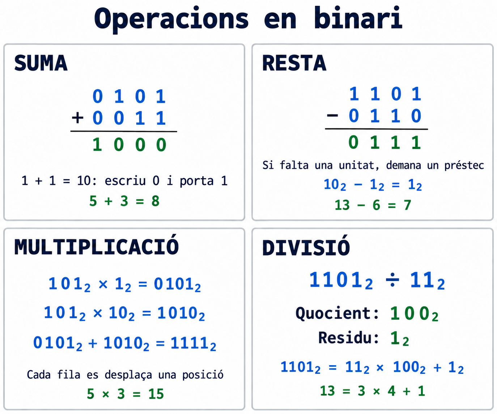
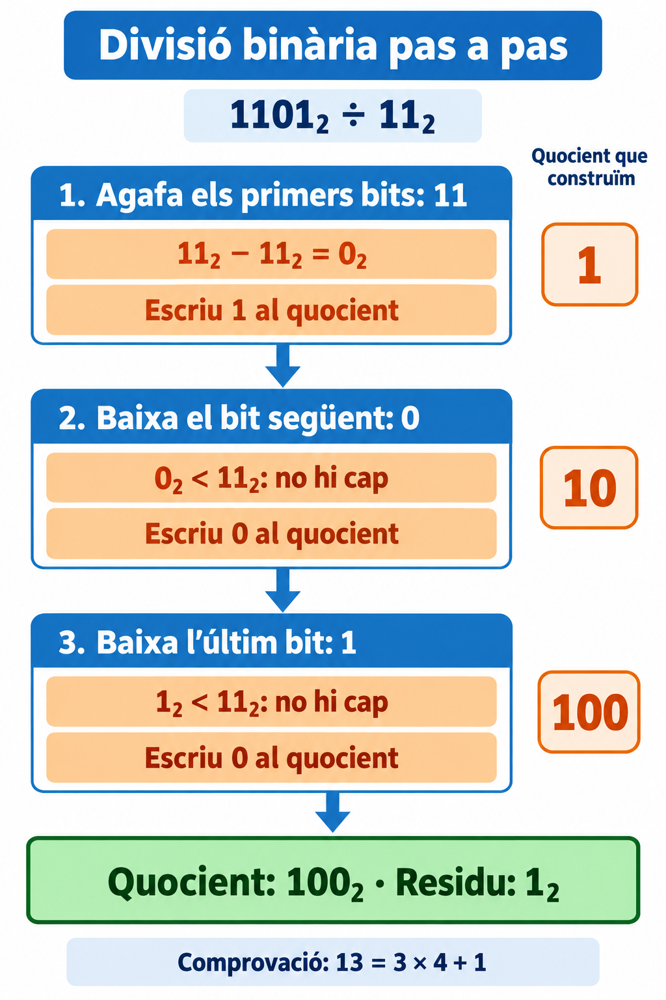

# Bloc 3. Sumes, restes, multiplicacions i divisions en binari

**Pregunta clau:** com podem calcular utilitzant només zeros i uns?

Les operacions en binari segueixen una idea que ja coneixes del decimal: treballem per columnes i respectem el valor de cada posició. La diferència és que **cada posició val el doble de la que té a la dreta**.

En aquest bloc treballarem amb **enters no negatius**, restes amb resultat no negatiu i divisions enteres amb quocient i residu. Podem afegir tants bits com necessitem per escriure el resultat.

## 1. Abans de començar

Repassa el [bloc de conversions](2_Sistemes_de_numeracio.md) si encara et costa llegir un nombre binari.

| Valor de la posició | 16 | 8 | 4 | 2 | 1 |
| --- | --- | --- | --- | --- | --- |
| Exemple: 10110₂ | 1 | 0 | 1 | 1 | 0 |

Aquest nombre val `16 + 4 + 2 = 22` en decimal.

Per operar:

1. **Alinea els nombres per la dreta.** Així les unitats queden sota les unitats.
2. Si et facilita el càlcul, completa amb **zeros a l'esquerra**: `101₂ = 0101₂`.
3. En sumes i restes, comença **per la columna de la dreta**.
4. Comprova el resultat convertint-lo a decimal.

!!! note "Com llegirem els exemples?"
    Tots els nombres dels càlculs en columna estan escrits en **binari**. Les comprovacions indicaran explícitament que estan en decimal. Recorda que `10₂` es llegeix «u, zero en binari» i val **dos**, no deu.



## 2. Suma binària: què passa quan arribem a dos?

### Les regles bàsiques

| Suma de bits | Resultat binari | Què escrivim a la columna? | Què portem a l'esquerra? |
| --- | --- | --- | --- |
| 0 + 0 | 0 | 0 | Res |
| 0 + 1 | 1 | 1 | Res |
| 1 + 0 | 1 | 1 | Res |
| 1 + 1 | 10 | 0 | 1 |
| 1 + 1 + 1 | 11 | 1 | 1 |

L'última fila apareix quan sumem dos bits que valen 1 i també arriba una **portada** de la columna anterior.

!!! tip "Per què portem un 1?"
    En decimal, deu unitats es converteixen en una desena. En binari, **dues unitats d'una columna es converteixen en una unitat de la columna de l'esquerra**. Per això `1 + 1 = 10₂`: escrivim 0 i portem 1.

### Exemple guiat: 0101₂ + 0011₂

```text
    0101
  + 0011
  ------
    1000
```

Seguim les columnes **de dreta a esquerra**:

| Pas | Columna que val… | Càlcul, incloent-hi la portada | Bit que escrivim | Portada següent |
| --- | --- | --- | --- | --- |
| 1 | 1 | 1 + 1 = 10₂ | 0 | 1 |
| 2 | 2 | 0 + 1 + 1 = 10₂ | 0 | 1 |
| 3 | 4 | 1 + 0 + 1 = 10₂ | 0 | 1 |
| 4 | 8 | 0 + 0 + 1 = 1₂ | 1 | 0 |

Els bits que hem anat escrivint ocupen les posicions de dreta a esquerra. El nombre complet és **1000₂**.

**Comprovació en decimal:** `5 + 3 = 8`.

### I si encara queda una portada al final?

```text
     111
  +    1
  ------
    1000
```

Les tres columnes produeixen un 0 i passen una portada a l'esquerra. L'última portada es converteix en un **nou bit inicial**.

**Comprovació en decimal:** `7 + 1 = 8`.

!!! warning "No perdis l'última portada"
    `111₂ + 1₂` necessita **4 bits**. Si només guardéssim els tres bits finals, obtindríem `000` i perdríem part del resultat. En un espai fix de 3 bits sense signe, això és un **desbordament**.

## 3. Resta binària: demanar un préstec

### Les regles bàsiques

| Resta | Resultat |
| --- | --- |
| 0 − 0 | 0 |
| 1 − 0 | 1 |
| 1 − 1 | 0 |
| 0 − 1 | Cal demanar un préstec a l'esquerra. |

Quan a la columna actual tenim 0 i n'hem de restar 1, necessitem **descompondre una unitat d'una columna situada a l'esquerra**.

Si la columna immediata de l'esquerra té un 1:

- Aquell 1 es converteix en 0 perquè ha prestat una unitat.
- La columna actual rep **dues unitats**, escrites `10₂`.
- Ara podem fer `10₂ − 1₂ = 1₂`.

!!! tip "Imagina un canvi de monedes"
    Una unitat de la columna que val 4 es pot canviar per dues unitats de la columna que val 2. El valor total es conserva: **4 = 2 + 2**.

### Exemple guiat: 1101₂ − 0110₂

```text
    1101
  − 0110
  ------
    0111
```

| Pas | Columna que val… | Què passa? | Bit del resultat |
| --- | --- | --- | --- |
| 1 | 1 | Fem 1 − 0. | 1 |
| 2 | 2 | Cal fer 0 − 1. Demanem al 1 de la columna que val 4; aquell 1 queda en 0. Aquí fem 10₂ − 1₂. | 1 |
| 3 | 4 | Ara aquí queda 0, però hem de restar 1. Demanem al 1 de la columna que val 8; aquell 1 queda en 0. Fem 10₂ − 1₂. | 1 |
| 4 | 8 | Després del préstec queda 0. Fem 0 − 0. | 0 |

**Resultat:** `0111₂`, que també podem escriure `111₂`.

**Comprovació en decimal:** `13 − 6 = 7`.

### Quan hi ha zeros entremig: 1000₂ − 0001₂

La columna de les unitats necessita un préstec, però les dues columnes següents tenen 0. Hem d'arribar fins al primer 1 de l'esquerra i passar el préstec per les columnes intermèdies.

La taula mostra **quantitats temporals en cada columna**, no dígits d'un nombre binari. El valor 2 vol dir dues unitats d'aquella columna.

| Estat del repartiment | Columna de 8 | Columna de 4 | Columna de 2 | Columna d'1 |
| --- | --- | --- | --- | --- |
| Situació inicial | 1 | 0 | 0 | 0 |
| Canviem una unitat de 8 per dues de 4 | 0 | 2 | 0 | 0 |
| Una de les dues unitats de 4 es canvia per dues de 2 | 0 | 1 | 2 | 0 |
| Una de les dues unitats de 2 es canvia per dues d'1 | 0 | 1 | 1 | 2 |
| Restem una unitat a la columna d'1 | 0 | 1 | 1 | 1 |

```text
    1000
  − 0001
  ------
    0111
```

**Comprovació en decimal:** `8 − 1 = 7`.

!!! warning "Actualitza la columna que ha prestat"
    No pots tornar a utilitzar el seu valor original. Si un 1 ha prestat la seva unitat, ara és un 0.

## 4. Multiplicació binària: copiar, desplaçar i sumar

### Només quatre regles

| Multiplicació | Resultat |
| --- | --- |
| 0 × 0 | 0 |
| 0 × 1 | 0 |
| 1 × 0 | 0 |
| 1 × 1 | 1 |

Per multiplicar per un sol bit:

- Si el bit és **1**, copiem el nombre.
- Si el bit és **0**, el producte és zero.

Quan el multiplicador té més bits, obtenim una fila per a cada bit, començant per la dreta. Cada nova fila es desplaça una posició a l'esquerra perquè correspon a una posició que val el doble.

### Exemple guiat: 101₂ × 11₂

```text
      101
  ×    11
  -------
     0101   ← primer 1: copiem 101
  +  1010   ← segon 1: copiem 101 i desplacem una posició
  -------
     1111
```

| Pas | Bit del multiplicador | Què representa? | Producte parcial |
| --- | --- | --- | --- |
| 1 | 1 de la dreta | Multiplicar per 1₂. | 0101 |
| 2 | 1 de l'esquerra | Multiplicar per 10₂, és a dir, per dos. | 1010 |
| 3 | Sumem les files | 0101 + 1010. | **1111** |

**Comprovació en decimal:** `5 × 3 = 15`.

### Exemple amb un zero: 101₂ × 101₂

```text
       101
  ×    101
  --------
     00101   ← bit de les unitats: 1
     00000   ← bit de la posició que val 2: 0
  +  10100   ← bit de la posició que val 4: 1
  --------
     11001
```

La fila del mig val zero, però **la seva posició continua comptant**. L'últim 1 està dues posicions a l'esquerra del primer; per això afegim dos zeros a `101`.

**Comprovació en decimal:** `5 × 5 = 25`.

!!! tip "Multiplicar per 10₂, 100₂ o 1000₂"
    Amb prou bits per guardar el resultat, afegir un zero a la dreta multiplica per 2; afegir-ne dos multiplica per 4; afegir-ne tres multiplica per 8. Exemple: **101₂ × 100₂ = 10100₂**, és a dir, `5 × 4 = 20` en decimal.

## 5. Divisió binària: comparar, restar i baixar un bit

En una divisió entera tenim quatre elements:

| Element | Què significa? |
| --- | --- |
| **Dividend** | El nombre que dividim. |
| **Divisor** | El nombre pel qual dividim. Ha de ser diferent de zero. |
| **Quocient** | El nombre de vegades que el divisor cap sencer en el dividend. |
| **Residu** | La quantitat que sobra. |

Sempre ha de complir-se:

> **Dividend = divisor × quocient + residu**

El residu ha de ser **més petit que el divisor** i no negatiu.

!!! note "Aquesta divisió té un objectiu diferent del bloc anterior"
    Al bloc 2 dividíem nombres decimals entre 2 per trobar-ne els bits. Ara **el dividend i el divisor ja estan escrits en binari** i calculem un quocient i un residu també en binari.

### El procediment

1. Comença per l'**esquerra del dividend** i agafa els primers bits necessaris perquè el divisor hi càpiga.
2. Escriu **1 al quocient** si hi cap i resta el divisor. Si no hi cap, escriu **0** i no restis.
3. Baixa el bit següent del dividend, col·locant-lo a la dreta del residu parcial.
4. Repeteix la comparació fins que no quedin bits per baixar.

En cada pas només decidim entre **0 i 1**. Un cop iniciat el quocient, cada bit que baixem produeix un nou bit del quocient, encara que sigui zero.

Si el dividend complet és més petit que el divisor, el quocient és **0** i el residu és el mateix dividend.

### Exemple guiat: 1101₂ ÷ 11₂

{ width="680" }

| Pas | Quantitat parcial | Comparació i operació | Bit que afegim al quocient | Quocient construït | Residu parcial |
| --- | --- | --- | --- | --- | --- |
| 1 | Agafem els primers `11` de `1101`. | 11₂ cap en 11₂. Restem 11₂ − 11₂. | 1 | 1 | 0 |
| 2 | Baixem el següent bit, `0`: tenim `00`, que val 0. | 0₂ és més petit que 11₂. No restem. | 0 | 10 | 0 |
| 3 | Baixem l'últim bit, `1`: tenim `01`, que val 1. | 1₂ és més petit que 11₂. No restem. | 0 | 100 | 1 |

Ja no queden bits per baixar: **quocient 100₂ i residu 1₂**.

**Comprovació en binari:** `11₂ × 100₂ + 1₂ = 1100₂ + 1₂ = 1101₂`.

**Comprovació en decimal:** `13 = 3 × 4 + 1`. El residu 1 és més petit que el divisor 3.

!!! warning "Els zeros del quocient són necessaris"
    El resultat és **100₂**, no `1₂`. Encara que no puguem restar el divisor en un pas, hem d'escriure el 0 que ocupa aquella posició.

### Un altre exemple: divisió exacta de 1111₂ entre 11₂

| Pas | Quantitat parcial | Acció | Quocient construït | Residu parcial |
| --- | --- | --- | --- | --- |
| 1 | 11 | Restem 11 − 11 i escrivim 1. | 1 | 0 |
| 2 | Baixem 1: tenim 1. | No hi cap 11; escrivim 0. | 10 | 1 |
| 3 | Baixem l'últim 1: tenim 11. | Restem 11 − 11 i escrivim 1. | 101 | 0 |

**Resultat:** quocient `101₂` i residu `0₂`. És una divisió **exacta** perquè no sobra res.

**Comprovació en decimal:** `15 = 3 × 5 + 0`.

## 6. Errors que podem evitar

| Error | Com el corregim? |
| --- | --- |
| Escriure un 2 dins d'un resultat binari. | Escrivim 0 en aquella columna i portem 1 a l'esquerra. |
| Oblidar la portada que arriba en una suma. | Anotem la portada abans de calcular la columna següent. |
| Fer un préstec sense modificar la columna d'origen. | Descomptem la unitat que aquella columna ha prestat. |
| Sumar tots els productes parcials sense desplaçar-los. | Respectem la posició del bit del multiplicador. |
| Saltar-se un zero del quocient. | Després de cada bit baixat, escrivim 0 o 1 al quocient. |
| Donar un residu igual o superior al divisor. | Revisem la divisió: encara hi cap almenys una vegada més. |

## 7. Practica: primer calcula, després comprova

Totes les operacions següents estan en **base 2**. Escriu les portades, els préstecs o els passos intermedis al full.

### A. Sumes

1. `101 + 10`
2. `1011 + 0110`
3. `1111 + 0001`

??? success "Solucions de les sumes"
    1. **111₂**. Sense portades. En decimal: `5 + 2 = 7`.
    2. **10001₂**. De dreta a esquerra: `1 + 0 = 1`; `1 + 1 = 10₂`; `0 + 1 + 1 = 10₂`; `1 + 0 + 1 = 10₂`. Escrivim l'última portada en una posició nova. En decimal: `11 + 6 = 17`.
    3. **10000₂**. La portada passa per totes les columnes i crea un bit nou. En decimal: `15 + 1 = 16`.

### B. Restes

4. `1110 − 0100`
5. `1010 − 0011`
6. `10000 − 00001`

??? success "Solucions de les restes"
    4. **1010₂**. No cal cap préstec. En decimal: `14 − 4 = 10`.
    5. **0111₂**. La columna de les unitats demana a la de valor 2. Després, la de valor 2 necessita un altre préstec, que arriba des de la de valor 8 passant per la de valor 4. En decimal: `10 − 3 = 7`.
    6. **01111₂**. El préstec travessa les columnes amb zero. En decimal: `16 − 1 = 15`.

### C. Multiplicacions

7. `110 × 10`
8. `111 × 11`
9. `101 × 101`

??? success "Solucions de les multiplicacions"
    7. **1100₂**. Multiplicar per 10₂ desplaça una posició a l'esquerra. En decimal: `6 × 2 = 12`.
    8. **10101₂**. Productes parcials: `00111 + 01110 = 10101`. En decimal: `7 × 3 = 21`.
    9. **11001₂**. Productes parcials: `00101 + 00000 + 10100 = 11001`. En decimal: `5 × 5 = 25`.

### D. Divisions enteres

Indica **quocient i residu**, encara que el residu sigui zero.

10. `1100 ÷ 11`
11. `1110 ÷ 11`
12. `10111 ÷ 101`

??? success "Solucions de les divisions"
    10. **Quocient 100₂, residu 0₂.** Agafem 11 i restem 11; després baixem cadascun dels dos zeros i escrivim un 0 per a cadascun. En decimal: `12 = 3 × 4 + 0`.
    11. **Quocient 100₂, residu 10₂.** Agafem 11 i restem 11; baixem 1 i escrivim 0; baixem 0, obtenim 10 i escrivim 0 perquè encara és menor que 11. En decimal: `14 = 3 × 4 + 2`.
    12. **Quocient 100₂, residu 11₂.** Agafem 101 i restem 101; baixem 1 i escrivim 0; baixem l'últim 1, obtenim 11 i escrivim 0 perquè és menor que 101. En decimal: `23 = 5 × 4 + 3`.

## 8. Repte en parelles: troba i explica l'error

Un company ha escrit aquests resultats:

| Operació | Resposta del company |
| --- | --- |
| 11₂ + 1₂ | 20₂ |
| 1000₂ − 1₂ | 1001₂ |
| 101₂ × 10₂ | 101₂ |
| 1101₂ ÷ 11₂ | Quocient 1₂ i residu 1₂ |

Per a cada fila:

1. Identifiqueu l'error amb una frase.
2. Feu l'operació correcta en binari.
3. Comproveu-la en decimal.

??? success "Correcció del repte"
    - **Suma:** el dígit 2 no existeix en binari. `11₂ + 1₂ = 100₂`; en decimal, `3 + 1 = 4`.
    - **Resta:** cal demanar i propagar el préstec. `1000₂ − 1₂ = 111₂`; en decimal, `8 − 1 = 7`.
    - **Multiplicació:** falta desplaçar una posició. `101₂ × 10₂ = 1010₂`; en decimal, `5 × 2 = 10`.
    - **Divisió:** falten els dos zeros del quocient. Quocient `100₂` i residu `1₂`; en decimal, `13 = 3 × 4 + 1`.

## 9. Què has de saber explicar sense mirar els apunts?

- Per què `1 + 1` s'escriu `10₂` i què és una portada.
- Per què un préstec aporta dues unitats a la columna immediata de la dreta.
- Per què desplacem els productes parcials en una multiplicació.
- Quan escrivim 0 o 1 al quocient d'una divisió.
- Com comprovem una divisió amb **divisor × quocient + residu**.
