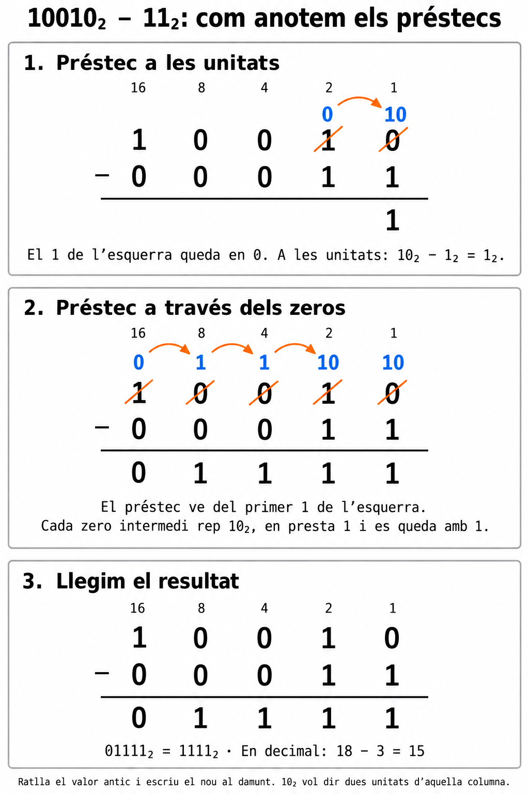
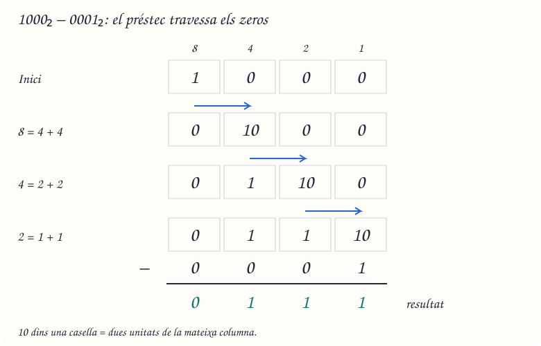
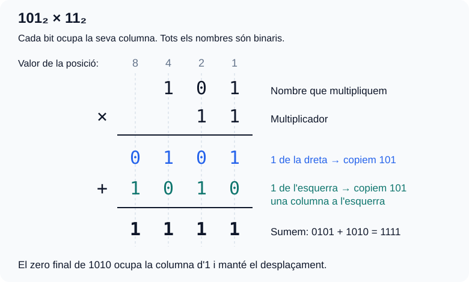
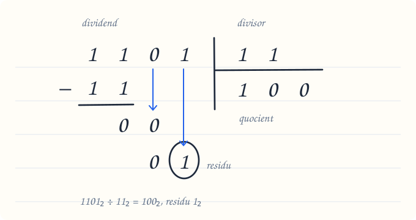
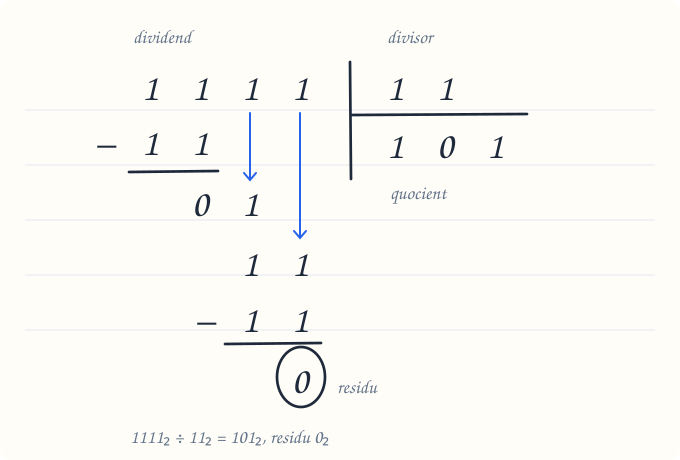

# Bloc 3. Sumes, restes, multiplicacions i divisions en binari

**Pregunta clau:** com podem calcular utilitzant només zeros i uns?

Les operacions en binari segueixen una idea que ja coneixes del decimal: treballem per columnes i respectem el valor de cada posició. La diferència és que **cada posició val el doble de la que té a la dreta**.

En aquest bloc treballarem amb **enters no negatius**, restes amb resultat no negatiu i divisions enteres amb quocient i residu. Podem afegir tants bits com necessitem per escriure el resultat.

## 1. Abans de començar

Repassa el [bloc de conversions](2_Sistemes_de_numeracio.md) si encara et costa llegir un nombre binari.

| Valor de la posició | 16 | 8 | 4 | 2 | 1 |
| --- | --- | --- | --- | --- | --- |
| Exemple: 10110₂ | 1 | 0 | 1 | 1 | 0 |

Aquest nombre val `16 + 4 + 2 = 22` en decimal.

Per operar:

1. **Alinea els nombres per la dreta.** Així les unitats queden sota les unitats.
2. Si et facilita el càlcul, completa amb **zeros a l'esquerra**: `101₂ = 0101₂`.
3. En sumes i restes, comença **per la columna de la dreta**.
4. Comprova el resultat convertint-lo a decimal.

!!! note "Com llegirem els exemples?"
    Tots els nombres dels càlculs en columna estan escrits en **binari**. Les comprovacions indicaran explícitament que estan en decimal. Recorda que `10₂` es llegeix «u, zero en binari» i val **dos**, no deu.


## 2. Suma binària: què passa quan arribem a dos?

### Les regles bàsiques

| Suma de bits | Resultat binari | Què escrivim a la columna? | Què portem a l'esquerra? |
| --- | --- | --- | --- |
| 0 + 0 | 0 | 0 | Res |
| 0 + 1 | 1 | 1 | Res |
| 1 + 0 | 1 | 1 | Res |
| 1 + 1 | 10 | 0 | 1 |
| 1 + 1 + 1 | 11 | 1 | 1 |

L'última fila apareix quan sumem dos bits que valen 1 i també arriba una **portada** de la columna anterior.

!!! tip "Per què portem un 1?"
    En decimal, deu unitats es converteixen en una desena. En binari, **dues unitats d'una columna es converteixen en una unitat de la columna de l'esquerra**. Per això `1 + 1 = 10₂`: escrivim 0 i portem 1.

### Exemple guiat: 0101₂ + 0011₂

```text
    0101
  + 0011
  ------
    1000
```

Seguim les columnes **de dreta a esquerra**:

| Pas | Columna que val… | Càlcul, incloent-hi la portada | Bit que escrivim | Portada següent |
| --- | --- | --- | --- | --- |
| 1 | 1 | 1 + 1 = 10₂ | 0 | 1 |
| 2 | 2 | 0 + 1 + 1 = 10₂ | 0 | 1 |
| 3 | 4 | 1 + 0 + 1 = 10₂ | 0 | 1 |
| 4 | 8 | 0 + 0 + 1 = 1₂ | 1 | 0 |

Els bits que hem anat escrivint ocupen les posicions de dreta a esquerra. El nombre complet és **1000₂**.

**Comprovació en decimal:** `5 + 3 = 8`.

### I si encara queda una portada al final?

```text
     111
  +    1
  ------
    1000
```

Les tres columnes produeixen un 0 i passen una portada a l'esquerra. L'última portada es converteix en un **nou bit inicial**.

**Comprovació en decimal:** `7 + 1 = 8`.

!!! warning "No perdis l'última portada"
    `111₂ + 1₂` necessita **4 bits**. Si només guardéssim els tres bits finals, obtindríem `000` i perdríem part del resultat. En un espai fix de 3 bits sense signe, això és un **desbordament**.

## 3. Resta binària: demanar un préstec

| Resta | Resultat |
| --- | --- |
| 0 − 0 | 0 |
| 1 − 0 | 1 |
| 1 − 1 | 0 |
| 0 − 1 | Demanem un préstec a l'esquerra: 10₂ − 1₂ = 1₂. |

### Per què el préstec aporta dues unitats?

**Cada columna val el doble que la de la dreta.** Quan una columna presta un **1** a la seva veïna de la dreta, aquesta rep **dues unitats**, escrites **10₂**. Per exemple: **4 = 2 + 2**. La columna que presta perd aquella unitat: el seu **1 passa a 0**.

El `10₂` del préstec s'anota **dins de la mateixa columna**: representa dues unitats d'aquella posició.

### Exemple visual: 10010₂ − 00011₂

{ width="780" }

**Comprovació en decimal:** `18 − 3 = 15`.

### Quan el préstec travessa diverses columnes: 1000₂ − 0001₂

Si la columna del costat té **0**, busquem el primer **1 a l'esquerra**. El préstec passa de columna en columna: cada columna intermèdia rep dues unitats, **se'n queda una i en presta una a la dreta**.

{ width="780" }

**Resultat:** `1000₂ − 0001₂ = 0111₂`. En decimal: `8 − 1 = 7`.

!!! warning "Actualitza la columna que ha prestat"
    Fes servir els valors nous anotats al damunt, perquè els originals ja han canviat.

## 4. Multiplicació binària

### Taula de multiplicació

| × | 0 | 1 |
| --- | --- | --- |
| **0** | 0 | 0 |
| **1** | 0 | 1 |

Multipliquem pels bits del multiplicador **de dreta a esquerra**: amb un **1**, copiem el nombre; amb un **0**, escrivim zeros. Cada fila es desplaça **una posició més a l'esquerra**. Al final, sumem les files.

### Exemple visual: 101₂ × 11₂

{ width="780" }

**Comprovació en decimal:** `5 × 3 = 15`.

## 5. Divisió binària

El **dividend** és el nombre que dividim i el **divisor** és el nombre pel qual dividim, que no pot ser zero. Obtenim un **quocient** i un **residu**.

1. Comença per l'esquerra i agafa els primers bits on càpiga el divisor.
2. Escriu **1 al quocient** si hi cap i resta el divisor; si no hi cap, escriu **0**.
3. Baixa el bit següent a la dreta del residu parcial i repeteix fins al final. **No et saltis els zeros del quocient.**

Si el dividend és més petit que el divisor, el quocient és **0** i el residu és el dividend.

### Exemple visual: 1101₂ ÷ 11₂

{ width="680" }

**Per què baixem els bits i no restem?** Després de fer `11₂ − 11₂`, queda **0**, però encara falten bits del dividend per utilitzar. Els baixem **un a un, en ordre**, per continuar la divisió. Baixar un bit equival a multiplicar el residu parcial per dos i afegir-hi aquell bit.

- Baixem el **0**: tenim `00₂ = 0₂`. És més petit que `11₂`: el divisor hi cap **zero vegades**, així que escrivim **0 al quocient** i no restem.
- Baixem l'**1**: tenim `01₂ = 1₂`. També és més petit que `11₂`: escrivim un altre **0 al quocient** i no restem.

**Escriure el 0 al quocient és el resultat d'aquell pas.** Si restéssim `11₂`, obtindríem un valor negatiu. Com que ja no queden bits per baixar, l'**1** final és el residu.

**Resultat:** quocient **100₂**, residu **1₂**.

**Comprovació en decimal:** `13 = 3 × 4 + 1`.

### Un altre dibuix: 1111₂ ÷ 11₂ (només baixem uns)

{ width="680" }

- Restem els primers `11₂ − 11₂`: queda **0** i escrivim **1 al quocient**.
- Baixem el primer **1**: tenim `01₂ = 1₂`. No hi cap `11₂`, així que escrivim **0 al quocient**.
- Baixem el segon **1**: ara tenim `11₂`. El divisor hi cap una vegada: escrivim **1 al quocient** i fem `11₂ − 11₂ = 0₂`.

**Resultat:** quocient **101₂**, residu **0₂**. És una divisió exacta.

**Comprovació en decimal:** `15 = 3 × 5 + 0`.

Recorda: **dividend = divisor × quocient + residu**, amb el residu no negatiu i més petit que el divisor.

## 6. Errors que podem evitar

| Error | Com el corregim? |
| --- | --- |
| Escriure un 2 dins d'un resultat binari. | Escrivim 0 en aquella columna i portem 1 a l'esquerra. |
| Oblidar la portada que arriba en una suma. | Anotem la portada abans de calcular la columna següent. |
| Fer un préstec sense modificar la columna d'origen. | Descomptem la unitat que aquella columna ha prestat. |
| Sumar tots els productes parcials sense desplaçar-los. | Respectem la posició del bit del multiplicador. |
| Saltar-se un zero del quocient. | Després de cada bit baixat, escrivim 0 o 1 al quocient. |
| Donar un residu igual o superior al divisor. | Revisem la divisió: encara hi cap almenys una vegada més. |

## 7. Practica: primer calcula, després comprova

Totes les operacions següents estan en **base 2**. Escriu les portades, els préstecs o els passos intermedis al full.

### A. Sumes

1. `101 + 10`
2. `1011 + 0110`
3. `1111 + 0001`

??? success "Solucions de les sumes"
    1. **111₂**. Sense portades. En decimal: `5 + 2 = 7`.
    2. **10001₂**. De dreta a esquerra: `1 + 0 = 1`; `1 + 1 = 10₂`; `0 + 1 + 1 = 10₂`; `1 + 0 + 1 = 10₂`. Escrivim l'última portada en una posició nova. En decimal: `11 + 6 = 17`.
    3. **10000₂**. La portada passa per totes les columnes i crea un bit nou. En decimal: `15 + 1 = 16`.

### B. Restes

4. `1110 − 0100`
5. `1010 − 0011`
6. `10000 − 00001`

??? success "Solucions de les restes"
    4. **1010₂**. No cal cap préstec. En decimal: `14 − 4 = 10`.
    5. **0111₂**. La columna de les unitats demana a la de valor 2. Després, la de valor 2 necessita un altre préstec, que arriba des de la de valor 8 passant per la de valor 4. En decimal: `10 − 3 = 7`.
    6. **01111₂**. El préstec travessa les columnes amb zero. En decimal: `16 − 1 = 15`.

### C. Multiplicacions

7. `110 × 10`
8. `111 × 11`
9. `101 × 101`

??? success "Solucions de les multiplicacions"
    7. **1100₂**. Multiplicar per 10₂ desplaça una posició a l'esquerra. En decimal: `6 × 2 = 12`.
    8. **10101₂**. Productes parcials: `00111 + 01110 = 10101`. En decimal: `7 × 3 = 21`.
    9. **11001₂**. Productes parcials: `00101 + 00000 + 10100 = 11001`. En decimal: `5 × 5 = 25`.

### D. Divisions enteres

Indica **quocient i residu**, encara que el residu sigui zero.

10. `1100 ÷ 11`
11. `1110 ÷ 11`
12. `10111 ÷ 101`

??? success "Solucions de les divisions"
    10. **Quocient 100₂, residu 0₂.** Agafem 11 i restem 11; després baixem cadascun dels dos zeros i escrivim un 0 per a cadascun. En decimal: `12 = 3 × 4 + 0`.
    11. **Quocient 100₂, residu 10₂.** Agafem 11 i restem 11; baixem 1 i escrivim 0; baixem 0, obtenim 10 i escrivim 0 perquè encara és menor que 11. En decimal: `14 = 3 × 4 + 2`.
    12. **Quocient 100₂, residu 11₂.** Agafem 101 i restem 101; baixem 1 i escrivim 0; baixem l'últim 1, obtenim 11 i escrivim 0 perquè és menor que 101. En decimal: `23 = 5 × 4 + 3`.

## 8. Repte en parelles: troba i explica l'error

Un company ha escrit aquests resultats:

| Operació | Resposta del company |
| --- | --- |
| 11₂ + 1₂ | 20₂ |
| 1000₂ − 1₂ | 1001₂ |
| 101₂ × 10₂ | 101₂ |
| 1101₂ ÷ 11₂ | Quocient 1₂ i residu 1₂ |

Per a cada fila:

1. Identifiqueu l'error amb una frase.
2. Feu l'operació correcta en binari.
3. Comproveu-la en decimal.

??? success "Correcció del repte"
    - **Suma:** el dígit 2 no existeix en binari. `11₂ + 1₂ = 100₂`; en decimal, `3 + 1 = 4`.
    - **Resta:** cal demanar i propagar el préstec. `1000₂ − 1₂ = 111₂`; en decimal, `8 − 1 = 7`.
    - **Multiplicació:** falta desplaçar una posició. `101₂ × 10₂ = 1010₂`; en decimal, `5 × 2 = 10`.
    - **Divisió:** falten els dos zeros del quocient. Quocient `100₂` i residu `1₂`; en decimal, `13 = 3 × 4 + 1`.

## 9. Què has de saber explicar sense mirar els apunts?

- Per què `1 + 1` s'escriu `10₂` i què és el llevat.
- Per què un préstec aporta dues unitats a la columna immediata de la dreta.
- Per què desplacem els productes parcials en una multiplicació.
- Quan escrivim 0 o 1 al quocient d'una divisió.
- Com comprovem una divisió amb **divisor × quocient + residu**.
