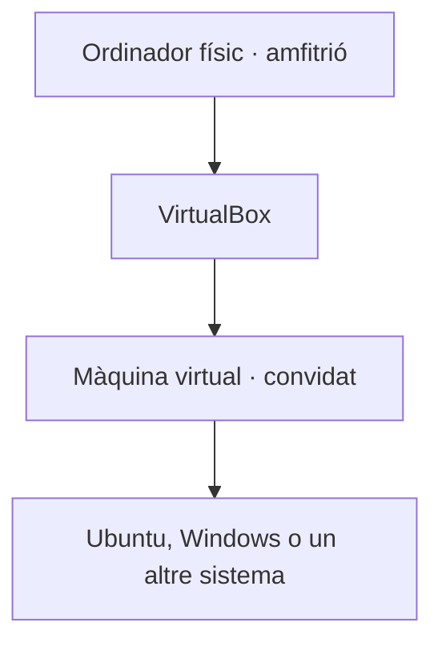
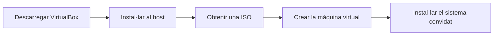
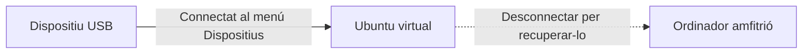

# Bloc 5. Màquines virtuals amb VirtualBox

## Què és VirtualBox?

**Oracle VirtualBox** és un programa de virtualització: permet executar un ordinador virtual dins del nostre ordinador físic. L'ordinador físic és l'**amfitrió** (*host*) i el sistema operatiu instal·lat a la màquina virtual és el **convidat** (*guest*).



La màquina virtual té maquinari virtual propi —com ara memòria, processador, disc i xarxa—, però utilitza els recursos de l'ordinador amfitrió.

## Instal·lació i primera configuració

1. Ves al [web oficial de descàrregues de VirtualBox](https://www.virtualbox.org/wiki/Downloads) i tria el paquet per al sistema operatiu de l'ordinador amfitrió.
2. Executa l'instal·lador i accepta els permisos necessaris. En alguns sistemes caldrà autoritzar controladors de xarxa o reiniciar.
3. Baixa la imatge ISO del sistema operatiu que vols instal·lar a la màquina virtual.
4. A VirtualBox, crea una màquina virtual, selecciona el sistema operatiu i la ISO, i assigna memòria, processadors i espai de disc.



### Abans de començar

- **Virtualització a la BIOS/UEFI:** comprova que la virtualització de maquinari estigui activada. Pot aparèixer com **Intel VT-x**, **Intel Virtualization Technology**, **AMD-V** o **SVM Mode**. El nom i la ubicació varien segons l'ordinador; normalment es configura a la BIOS/UEFI i cal reiniciar. Si està desactivada, les màquines virtuals de 64 bits poden no iniciar-se o funcionar malament.
- **Recursos:** reserva prou memòria i processadors per al sistema amfitrió. No assignis a la màquina virtual tots els recursos de l'ordinador.
- **Controladors i xarxa:** durant la instal·lació, el sistema pot demanar permís per instal·lar controladors. A Windows, la xarxa pot interrompre's breument mentre s'instal·len els adaptadors virtuals.
- **Hyper-V a Windows:** si una màquina virtual va molt lenta o no s'inicia, Hyper-V o altres funcions de virtualització de Windows poden influir-hi. Comprova la configuració abans de canviar-la i no desactivis funcions de seguretat d'un equip gestionat sense consultar-ne l'administrador.

## Aturar la màquina virtual

Quan tanques una màquina virtual en execució, VirtualBox ofereix diverses opcions:

| Opció | Què fa? | Quan convé? |
| --- | --- | --- |
| **Desar l'estat de la màquina** | Desa l'estat actual i tanca la finestra. En tornar-la a iniciar, continua aproximadament on era. | Si vols reprendre la feina més tard sense tancar els programes. |
| **Enviar el senyal d'aturada** | Demana al sistema convidat que s'apagui de manera normal, com si premessis el botó d'engegada de l'ordinador. | Per apagar la màquina virtual sense perdre dades. Cal que el sistema convidat respongui al senyal. |
| **Apagar la màquina** | Talla l'alimentació virtual immediatament. És com desconnectar l'ordinador de l'endoll. | Només si el sistema s'ha quedat bloquejat i no respon. Es poden perdre dades no desades o malmetre fitxers. |

La forma més segura és **desar la feina i apagar el sistema des del menú d'Ubuntu o Windows convidat**. També pots triar **Enviar el senyal d'aturada** al diàleg de tancament de VirtualBox. No facis servir **Apagar la màquina** com a forma habitual d'aturada.

## Guest Additions a Ubuntu

Les **Guest Additions** s'instal·len dins del sistema convidat. Milloren la integració amb l'amfitrió: ajust automàtic de la mida de pantalla, millor moviment del ratolí i funcions com el porta-retalls compartit.

1. Inicia Ubuntu i, a la finestra de VirtualBox, selecciona **Dispositius → Insereix la imatge de CD de les Guest Additions** (*Devices → Insert Guest Additions CD Image*).
2. A Ubuntu, obre el CD muntat i executa `VBoxLinuxAdditions.run` com a administrador. Si apareix la finestra d'execució del programari, selecciona **Executar**. També ho pots fer des d'un terminal. El CD normalment es munta a `/media/$USER/VBox_GAs_<versió>`; entra a la carpeta (el nom inclou la versió instal·lada):

   ```bash
   cd /media/$USER/VBox_GAs_*/
   sudo sh ./VBoxLinuxAdditions.run
   ```

3. **Només si l'instal·lador indica que falten eines o capçaleres del nucli**, instal·la-les:

   ```bash
   sudo apt update
   sudo apt install build-essential dkms linux-headers-$(uname -r)
   ```

   Aquest pas no cal fer-lo sempre: prepara Ubuntu per compilar els mòduls quan les eines necessàries no hi són. Quan acabi, **torna a executar l'instal·lador de les Guest Additions des del CD** (pas 2).

4. Reinicia Ubuntu perquè els controladors s'activin:

   ```bash
   sudo reboot
   ```

Les Guest Additions han de correspondre a la versió de VirtualBox instal·lada a l'amfitrió. Si Secure Boot impedeix carregar algun mòdul, segueix l'avís d'Ubuntu per autoritzar-lo o consulta l'administrador de l'equip.

## Connectar un dispositiu USB

Per passar un USB de l'ordinador amfitrió a la màquina virtual:

1. Apaga la màquina virtual i obre **Configuració → USB**.
2. Activa el controlador USB que necessitis. Per a **USB 2.0 o USB 3.0**, instal·la també l'**Extension Pack** oficial de la mateixa versió que VirtualBox. El pots baixar del web oficial i instal·lar des de **Eines → Extension Pack Manager**. Després, torna a obrir la configuració de la màquina virtual.
3. Inicia la màquina virtual. Al menú **Dispositius → USB**, selecciona el dispositiu que vols connectar.
4. Per tornar-lo a l'amfitrió, desmarca'l al mateix menú abans de fer-lo servir fora de la màquina virtual.



Mentre l'USB està connectat al convidat, normalment no està disponible per a l'amfitrió. En un amfitrió Linux, també cal que el compte tingui permisos per utilitzar VirtualBox i els dispositius USB.

!!! note "Extension Pack i llicència"
    L'Extension Pack és diferent de les Guest Additions: s'instal·la a l'**amfitrió** i afegeix funcions com el suport USB 2.0/3.0. Consulta les condicions de llicència vigents al [web oficial](https://www.virtualbox.org/wiki/Downloads), especialment si l'ús no és personal o educatiu.

Fonts: [descàrregues oficials de VirtualBox](https://www.virtualbox.org/wiki/Downloads), [manual de VirtualBox: Guest Additions](https://www.virtualbox.org/manual/ch04.html) i [manual de VirtualBox: configuració USB](https://www.virtualbox.org/manual/ch03.html#settings-usb).
